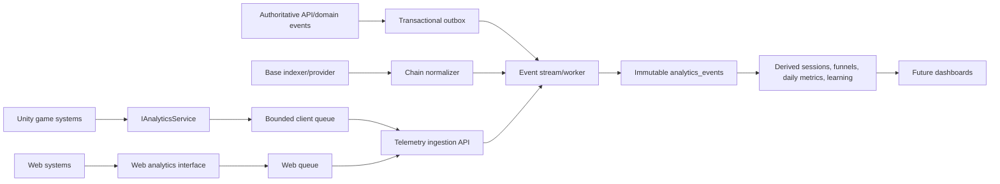

# Trap Wars V2 Analytics Foundation

Status: M4 authoritative telemetry specification
Date: 2026-08-11
Applies to: Unity, web, API, worker, Telegram adapters, and Base onboarding

## 1. Purpose

Trap Wars analytics exists to improve the game, verify that its financial learning design works, protect economy integrity, and communicate credible product traction. It is not a crypto-activity dashboard and it is not proof that a player is having fun.

The system must answer five product questions:

1. **Player acquisition**: Are people entering the product, and from where?
2. **Player activation**: Are they reaching a meaningful gameplay decision?
3. **Player engagement**: Are they exploring, choosing, returning, and continuing voluntarily?
4. **Player learning**: Are experiences changing later financial decisions?
5. **Player retention**: Do activated players come back and continue playing?

M4 defines events, ownership, formulas, privacy, transport, storage, quality controls, and dashboard requirements. It does not select an analytics vendor, create dashboards, instrument Unity, or rewrite the economy engine.

## 2. Analytics principles

1. Events describe observable facts, not conclusions such as `player_had_fun`.
2. Meaningful economic outcomes originate from server domain events, never client claims.
3. Blockchain events originate from verified chain data and include finality/reorg handling.
4. Client observations are useful for presentation, usability, exploration, and performance only.
5. Event names and fields are stable, versioned contracts shared across products.
6. Raw events are immutable; corrections and new interpretations create new events or rebuilt aggregates.
7. Derived metrics are reproducible from raw events and documented formulas.
8. Anonymous and authenticated telemetry are stitched only through an explicit first-party identity transition.
9. Analytics failure never blocks gameplay, an economic command, or account recovery.
10. Data collection is minimized, consent-aware, testable, and separated from operational secrets.
11. Internal, automated, bot, QA, and investor-demo traffic is labeled and excluded from product KPIs by default.
12. `VERTICAL_SLICE_CITY_TBD` is a replaceable content ID; telemetry must not hard-code Compton or another final city.

## 3. Naming standard

Canonical event pattern:

```text
domain.action
```

Rules:

- Lowercase ASCII only.
- Exactly one dot separates a stable singular domain from an action.
- Compound actions use `snake_case`: `npc.interaction_started`.
- Actions describe completed observations or received intentions: `session.started`, `market.trade_requested`.
- Do not encode versions, locations, platforms, outcomes, or experiments in the event name. Those are fields.
- Do not create near-synonyms such as `trade_done`, `purchase_success`, and `market.trade_completed`.
- Renaming meaning creates a new event or event version; dashboards do not reinterpret old payloads silently.

Examples:

- Valid: `session.started`, `player.control_acquired`, `rumor.investigated`, `education.reveal_completed`.
- Invalid: `SessionStart`, `unity_market_trade_v2`, `userClickedGreenBuyButton`, `comptonRumorDone`.

Property names use lowercase `snake_case`. IDs end in `_id`; timestamps end in `_at`; durations end in `_ms`; currency amounts include a unit or currency suffix.

## 4. Event envelope

Every event uses the same envelope. Nullable fields remain present only when useful to the selected transport/schema format; requiredness is defined by source and event schema.

```json
{
  "event_id": "uuid-v7-or-equivalent",
  "event_name": "market.trade_completed",
  "event_version": 1,
  "schema_version": 1,
  "occurred_at": "2026-08-11T18:00:00.000Z",
  "received_at": "2026-08-11T18:00:00.125Z",
  "session_id": "session-id",
  "anonymous_id": "optional-first-party-id",
  "player_id": "optional-platform-player-id",
  "run_id": "optional-run-id",
  "correlation_id": "request-or-flow-id",
  "causation_id": "optional-parent-command-or-event-id",
  "source": "unity|web|api|worker|telegram|base_indexer",
  "authority": "client_observation|server_authority|blockchain_authority",
  "environment": "local|dev|preview|staging|production",
  "build_version": "client-or-service-build",
  "platform": "windows|macos|webgl|web|telegram|server",
  "sequence_number": 42,
  "state_version": 17,
  "economy_version": "economy-version",
  "content_version": "content-version",
  "balance_version": "balance-version",
  "random_strategy_version": "random-strategy-version",
  "consent_state": "essential_only|analytics_allowed|withdrawn|unknown",
  "properties": {}
}
```

### 4.1 Required common fields

| Field | Rule |
| --- | --- |
| `event_id` | Globally unique and generated once before first queue attempt; reused on retries |
| `event_name` | Registered canonical name |
| `event_version` | Payload contract version for this event |
| `schema_version` | Shared envelope version |
| `occurred_at` | Source-observed UTC time; client time is not trusted for economy ordering |
| `received_at` | Added by ingestion service in UTC |
| `session_id` | Required for interactive Unity/web events; service jobs use a job correlation instead |
| `player_id` | Required after authenticated identity exists when policy allows |
| `run_id` | Required for run-scoped gameplay/economy events |
| `correlation_id` | Required for commands and multi-step flows; propagated across client/API/worker |
| `source` | Emitting subsystem |
| `authority` | One of the three ownership classes |
| `environment` | Required; non-production excluded from production KPIs |
| `build_version` | Required for client/service quality analysis |
| Version fields | Required for authoritative run events; optional before a run begins |
| `properties` | Schema-validated event-specific payload; arbitrary unbounded maps are rejected |

### 4.2 Identity and sequence fields

- `anonymous_id` is a random first-party installation/browser identifier, not a fingerprint.
- On account creation, the server records an approved alias transition from anonymous ID to player ID; events are not rewritten.
- `sequence_number` is monotonic within a client session for observations. Gaps are acceptable and measured.
- `state_version` is authoritative for run/economy events and must not be supplied as truth by a client.
- Event timestamps never replace server command order, domain-event sequence, state version, or blockchain position.

## 5. Event ownership

### 5.1 Client observation

Reports presentation and local behavior that only the client can observe:

- UI opened/closed and dwell time.
- Camera, input, accessibility, and quality setting changes.
- Dialogue presentation and optional interactions.
- Exploration and local zone presence when it has no authoritative gameplay effect.
- Frame time, stalls, client errors, and local idle periods.

Client observations can be dropped, delayed, duplicated, or fabricated. They inform UX analysis but cannot award value, prove a completed mission, settle a referral, or determine a leaderboard.

### 5.2 Server authority

Represents meaningful platform and gameplay state committed by V2 services:

- Player activation.
- Run start/progression/completion.
- Trade request receipt, validation, completion, or rejection.
- Cash, inventory, stash, reputation, knowledge, reward, and day changes.
- Referral attribution.
- Verified wallet ownership link.
- Server-derived learning opportunities and behavioral evidence.

Server events originate from committed domain events or transactional outbox records. The analytics copy may arrive later, but its event ID and economic values match the source domain record.

### 5.3 Blockchain authority

Represents verified chain facts observed by a trusted indexer/provider and normalized by backend services:

- Transaction included and finalized at the configured confidence level.
- Contract event finalized.
- Testnet achievement proof or future asset event finalized.

Blockchain events include `chain_id`, transaction hash or restricted reference, block number/hash, log index where applicable, confirmation/finality state, and linked internal operation ID. Reorgs produce explicit reversal/replacement records and rebuild projections; raw observations are not overwritten.

Wallet onboarding views and link challenges are not blockchain authority. A wallet signature verified by the backend is server authority; only chain settlement is blockchain authority.

## 6. Analytics architecture



Key boundaries:

- Client ingestion accepts only registered client-observation schemas.
- Server-authority events bypass the untrusted client ingestion path and originate from the transactional outbox.
- Blockchain-authority events originate from chain normalization, not browser callbacks.
- Raw collection and derived computation are vendor-neutral contracts. A vendor may receive a projection but does not become the only copy of authoritative telemetry.
- Delivery is asynchronous. Backpressure drops or samples low-value observations before authoritative events.

## 7. Event taxonomy

The following is the minimum M4 registry. `Owner` means origin authority, not which UI happens to display the event.

### 7.1 Acquisition, identity, and onboarding

| Event | Owner | Trigger | Required properties |
| --- | --- | --- | --- |
| `web.landing_viewed` | Client observation | Public product page becomes visible | `page_id`, `referrer_class`, `campaign_id?` |
| `launcher.opened` | Client observation | Game launcher becomes usable | `entry_source`, `build_offered` |
| `auth.signup_started` | Client observation | Player begins account creation | `provider_type`, `entry_source` |
| `auth.signup_completed` | Server authority | Platform player identity is committed | `provider_type`, `new_player` |
| `auth.login_completed` | Server authority | Login session is created | `provider_type`, `account_age_days` |
| `onboarding.step_started` | Client observation | A named onboarding step is presented | `flow_id`, `step_id`, `step_index` |
| `onboarding.step_completed` | Client or server by step | Step completes | `flow_id`, `step_id`, `duration_ms` |
| `onboarding.abandoned` | Derived/client observation | Flow exits or times out | `flow_id`, `last_step_id`, `reason` |
| `referral.invite_opened` | Client observation | Valid invite link opens first-party surface | `invite_id`, `channel` |
| `referral.attributed` | Server authority | One-time referral attribution commits | `attribution_id`, `channel`, `fraud_state` |
| `referral.invite_sent` | Client observation | Native share confirms or tracked share action completes | `channel`, `share_surface` |

Do not count a share-button click as a sent invite when the platform cannot confirm share completion. Report it separately as a UI interaction if useful.

### 7.2 Session and vertical-slice funnel

| Event | Owner | Trigger | Required properties |
| --- | --- | --- | --- |
| `session.started` | Server authority when online; client observation fallback | Play session begins | `entry_source`, `returning_player`, `career_run_count` |
| `session.ended` | Client observation or derived timeout | Normal exit, crash recovery, or inactivity end | `end_reason`, `duration_ms`, `active_duration_ms`, `idle_duration_ms` |
| `player.spawned` | Client observation | Playable character appears and scene is ready | `location_id`, `spawn_id`, `load_duration_ms` |
| `player.control_acquired` | Client observation | Movement and camera input are enabled | `location_id`, `time_from_session_start_ms` |
| `player.activated` | Server authority | First accepted meaningful market commitment occurs | `activation_type`, `run_id`, `time_from_first_session_ms` |
| `location.exited` | Client observation or server if gated | Player crosses a named location boundary | `location_id`, `exit_id`, `required_objective` |
| `location.entered` | Client observation or server if gated | Player enters a named zone | `location_id`, `zone_id`, `optional` |
| `travel.started` | Server authority when travel affects run state; client observation for presentation-only movement | Accepted travel begins | `travel_id`, `origin_location_id`, `destination_location_id`, `travel_mode` |
| `travel.completed` | Server authority when arrival affects run state | Arrival commits | `travel_id`, `origin_location_id`, `destination_location_id`, `duration_ms`, `day_advanced` |
| `world.night_transition_started` | Client observation | Authored transition begins | `location_id`, `day_index` |
| `world.night_transition_completed` | Client observation | Night state is visibly complete | `location_id`, `duration_ms` |
| `player.continue_selected` | Client observation | Player chooses to continue after objective/close | `surface`, `next_activity_id` |
| `player.exit_selected` | Client observation | Player voluntarily exits at close | `surface`, `reason?` |

**Activated player definition:** a player for whom the server emits `player.activated` after accepting the first meaningful capital commitment in a run. Account creation, launcher open, character spawn, market view, wallet link, or a malformed/insufficient-funds request does not activate a player.

### 7.3 World, interaction, dialogue, and customization

| Event | Owner | Trigger | Required properties |
| --- | --- | --- | --- |
| `world.optional_interaction_completed` | Client observation | Optional inspect/use interaction finishes | `interaction_id`, `location_id`, `duration_ms` |
| `exploration.zone_entered` | Client observation | Player enters an analytics exploration zone | `zone_id`, `location_id`, `optional`, `first_visit` |
| `exploration.zone_exited` | Client observation | Player exits zone | `zone_id`, `dwell_ms`, `interactions_count` |
| `npc.interaction_started` | Client observation | NPC dialogue/interaction presentation begins | `npc_id`, `interaction_id`, `reengagement_index` |
| `npc.interaction_completed` | Server authority when progression-bearing; otherwise client | Interaction reaches defined completion | `npc_id`, `interaction_id`, `duration_ms`, `progression_effect` |
| `dialogue.choice_selected` | Client observation | Player selects an authored choice | `dialogue_id`, `node_id`, `choice_id`, `decision_time_ms` |
| `dialogue.sequence_completed` | Client observation | Dialogue sequence reaches completion/skip | `dialogue_id`, `duration_ms`, `completion_mode` |
| `mission.started` | Server authority | Mission state commits active | `mission_id`, `attempt_number` |
| `mission.completed` | Server authority | Mission completion commits | `mission_id`, `attempt_number`, `duration_ms` |
| `mission.failed` | Server authority | Defined failure commits | `mission_id`, `attempt_number`, `failure_code` |
| `mission.retry_started` | Server authority | New attempt starts after failure/abandon | `mission_id`, `attempt_number`, `prior_failure_code` |
| `customization.opened` | Client observation | Customization surface opens | `surface`, `available_item_count` |
| `customization.item_previewed` | Client observation | Item preview is visible | `item_id`, `category_id` |
| `customization.applied` | Server authority when persistent | Selection commits to profile | `item_id`, `category_id`, `source` |
| `player.idle_started` | Client observation | No meaningful input for configured threshold | `location_id`, `phase_id`, `threshold_ms` |
| `player.idle_ended` | Client observation | Meaningful input resumes | `location_id`, `phase_id`, `idle_duration_ms` |

Analytics zones are data-driven content IDs. They are not hard-coded scene names and cannot be used as proof of server-authoritative travel or mission completion.

### 7.4 Rumors and investigation

| Event | Owner | Trigger | Required properties |
| --- | --- | --- | --- |
| `rumor.received` | Server authority | Rumor becomes available to the run | `rumor_id`, `source_npc_id`, `market_id`, `expires_at`, `confidence_tier` |
| `rumor.opened` | Client observation | Rumor detail becomes visible | `rumor_id`, `surface`, `time_since_received_ms` |
| `rumor.investigated` | Server authority | Defined investigation condition commits | `rumor_id`, `investigation_method`, `evidence_count` |
| `rumor.dismissed` | Client observation | Player dismisses without action | `rumor_id`, `surface`, `visible_duration_ms` |
| `rumor.expired` | Server authority | Rumor expires before/after use | `rumor_id`, `investigated`, `acted_on` |

### 7.5 Market and authoritative economy

| Event | Owner | Trigger | Required properties |
| --- | --- | --- | --- |
| `market.viewed` | Client observation | Market decision surface becomes usable | `market_id`, `asset_id`, `phase_id`, `position_state` |
| `market.decision_dwell_recorded` | Client observation | Market surface closes or trade submits | `market_id`, `asset_id`, `dwell_ms`, `resulting_action` |
| `market.trade_requested` | Server authority | API accepts a validly structured trade command for processing | `command_id`, `market_id`, `asset_id`, `side`, `quantity_minor`, `quoted_price_minor` |
| `market.trade_completed` | Server authority | Trade commits transactionally | `command_id`, `asset_id`, `side`, `quantity_minor`, `average_price_minor`, `cash_delta_minor`, `fee_minor`, `state_version` |
| `market.trade_rejected` | Server authority | Trade command is rejected | `command_id`, `asset_id`, `side`, `rejection_code`, `retryable` |
| `market.condition_changed` | Server authority | Authored or simulated market state changes | `market_id`, `scenario_id`, `condition_before`, `condition_after`, `random_decision_id?` |
| `market.event_presented` | Client observation | Player can perceive the market event | `market_id`, `scenario_id`, `presentation_channel`, `latency_from_server_ms` |
| `economy.balance_changed` | Server authority | Authoritative cash/reserve balance changes | `reason_code`, `currency_code`, `before_minor`, `delta_minor`, `after_minor` |
| `economy.inventory_changed` | Server authority | Inventory commits a change | `reason_code`, `asset_id`, `before_quantity`, `delta_quantity`, `after_quantity` |
| `economy.stash_changed` | Server authority | Stash deposit/withdrawal commits | `reason_code`, `asset_id`, `location_id`, `delta_quantity`, `remote_action` |
| `economy.outcome_resolved` | Server authority | Scenario profit/loss is final | `scenario_id`, `realized_pnl_minor`, `capital_committed_minor`, `outcome_class`, `decision_path_id` |
| `economy.random_outcome_resolved` | Server authority | Authoritative random branch commits | `random_decision_id`, `random_strategy_version`, `outcome_code`, `evidence_reference` |
| `action.rejected` | Server authority | Non-trade gameplay command rejects | `command_type`, `rejection_code`, `retryable`, `state_version` |

`market.trade_completed`, balance, inventory, outcome, reward, score, and progression values are never accepted from Unity or web analytics payloads.

### 7.6 Runs, days, progression, and referrals

| Event | Owner | Trigger | Required properties |
| --- | --- | --- | --- |
| `run.started` | Server authority | New run is committed | `career_run_number`, version fields, `start_location_id` |
| `run.progressed` | Server authority | Named phase/objective commits | `phase_id`, `objective_id`, `progress_index` |
| `run.completed` | Server authority | Run reaches completion | `completion_type`, `duration_ms`, `final_score_minor`, `career_run_number` |
| `run.failed` | Server authority | Explicit failure condition commits | `failure_code`, `phase_id`, `duration_ms` |
| `run.abandoned` | Server authority/derived | Run expires or player confirms abandonment | `phase_id`, `reason`, `last_activity_at` |
| `day.started` | Server authority | Day state begins | `day_index`, `actions_available` |
| `day.completed` | Server authority | Day resolution commits | `day_index`, `actions_used`, `pnl_minor`, `events_resolved_count` |
| `progression.changed` | Server authority | Reputation/access/knowledge/lifestyle changes | `progression_type`, `reason_code`, `before_value`, `delta_value`, `after_value` |
| `reward.earned` | Server authority | Simulated or future approved reward commits | `reward_id`, `reward_type`, `value_class`, `reason_code` |
| `referral.conversion_qualified` | Server authority | Referred player reaches approved qualification | `attribution_id`, `qualification_type`, `fraud_state` |

During the foundation slice, `reward.earned` must use `value_class=simulated` or a valueless test proof. It must not imply a financial claim.

### 7.7 Education and behavioral learning

| Event | Owner | Trigger | Required properties |
| --- | --- | --- | --- |
| `education.concept_experienced` | Server authority | Gameplay state creates the intended concept experience | `concept_id`, `experience_id`, `scenario_id`, `outcome_class` |
| `education.reveal_shown` | Client observation | Formal reveal is visibly presented | `concept_id`, `reveal_id`, `time_since_experience_ms` |
| `education.explanation_opened` | Client observation | Optional deeper explanation opens | `concept_id`, `explanation_id`, `entry_surface` |
| `education.explanation_completed` | Client observation | Defined explanation completion is reached | `concept_id`, `explanation_id`, `duration_ms`, `completion_mode` |
| `education.reveal_completed` | Client observation | Primary reveal completes or is intentionally dismissed | `concept_id`, `reveal_id`, `duration_ms`, `completion_mode` |
| `education.behavior_opportunity_created` | Server authority | Later scenario presents a valid use of the concept | `concept_id`, `opportunity_id`, `difficulty_tier`, `prior_exposures` |
| `education.behavior_observed` | Server authority | Player decision at opportunity is classified | `concept_id`, `opportunity_id`, `behavior_code`, `aligned_with_concept`, `cost_context` |
| `education.mistake_repeated` | Derived server event | Same defined error repeats after reveal | `concept_id`, `mistake_code`, `repeat_index`, `opportunity_id` |
| `education.mastery_indicated` | Derived server event | Approved behavioral threshold is reached | `concept_id`, `evidence_count`, `opportunity_count`, `model_version` |

`mastery_indicated` is a product signal, not a credential or proof of financial competence.

### 7.8 Wallet and blockchain

| Event | Owner | Trigger | Required properties |
| --- | --- | --- | --- |
| `wallet.onboarding_started` | Client observation | Optional wallet flow opens | `provider_type`, `entry_surface`, `testnet` |
| `wallet.onboarding_step_completed` | Client or server by step | Named step completes | `provider_type`, `step_id`, `duration_ms` |
| `wallet.onboarding_failed` | Client/server observation | Flow fails | `provider_type`, `step_id`, `error_code`, `retryable` |
| `wallet.onboarding_abandoned` | Client observation/derived | Player exits or times out | `provider_type`, `last_step_id`, `reason` |
| `wallet.link_requested` | Server authority | Ownership challenge is issued | `wallet_link_id`, `provider_type`, `chain_id` |
| `wallet.link_verified` | Server authority | Signed challenge verifies and link commits | `wallet_link_id`, `provider_type`, `chain_id`, `address_token` |
| `chain.transaction_submitted` | Server authority | Backend submits/records expected transaction | `operation_id`, `chain_id`, `transaction_reference`, `sponsored` |
| `chain.transaction_finalized` | Blockchain authority | Configured chain finality is observed | `operation_id`, `chain_id`, `transaction_reference`, `block_number`, `finality_policy` |
| `chain.transaction_failed` | Server or blockchain authority | Submission/receipt indicates failure | `operation_id`, `chain_id`, `failure_code`, `failure_stage` |
| `chain.event_reverted` | Blockchain authority | Reorg/reversal invalidates prior observation | `operation_id`, `reverted_event_id`, `chain_id`, `reason` |

Analytics uses `wallet_link_id` or keyed `address_token` by default, not raw wallet addresses. Production and testnet scorecards remain separate.

### 7.9 UI, settings, reliability, and performance

| Event | Owner | Trigger | Required properties |
| --- | --- | --- | --- |
| `ui.surface_opened` | Client observation | Registered UI surface opens | `surface_id`, `entry_method`, `game_phase` |
| `ui.surface_closed` | Client observation | Surface closes | `surface_id`, `duration_ms`, `exit_method` |
| `settings.changed` | Client observation | Player changes a setting | `setting_id`, `value_class`, `game_phase` |
| `input.device_changed` | Client observation | Active device changes | `from_device`, `to_device` |
| `performance.sample_recorded` | Client observation | Sample window completes | `scene_id`, `quality_tier`, `fps_avg`, `frame_ms_p95`, `memory_mb` |
| `performance.stall_detected` | Client observation | Frame/loading stall exceeds threshold | `scene_id`, `stall_ms`, `game_phase` |
| `client.error_observed` | Client observation | Registered recoverable/unhandled error occurs | `error_code`, `system_id`, `recoverable`; no raw exception secrets |
| `connection.state_changed` | Client observation | API connectivity changes | `from_state`, `to_state`, `offline_duration_ms?` |
| `telemetry.batch_dropped` | Client observation/operational counter | Queue drops a batch | `reason`, `event_count`, `oldest_age_ms` |

High-volume performance samples use deterministic sampling and device/cohort weighting. Error stack traces belong in a separately governed crash system with redaction, not arbitrary analytics properties.

## 8. Vertical-slice funnel

Canonical slice stages:

```text
session.started
-> player.control_acquired
-> location.exited (safehouse)
-> rumor.received
-> rumor.investigated
-> npc.interaction_completed (primary contact)
-> market.viewed
-> player.activated / market.trade_requested
-> market.event_presented
-> economy.outcome_resolved
-> education.reveal_completed
-> world.night_transition_completed
-> rumor.received (next opportunity hook)
-> player.continue_selected OR player.exit_selected/session.ended
```

Funnel rules:

- Each stage has a stable `stage_id` and qualifying event predicate.
- Stages are calculated in order per run; repeated events do not advance the same stage twice.
- Report player conversion, run conversion, median time-to-stage, p90 time-to-stage, and drop-off after each stage.
- A stage reached offline may arrive late; aggregates restate within the late-arrival window.
- Separate technical failure, voluntary exit, idle timeout, and gameplay rejection drop-offs.
- Segment by build, platform, input device, acquisition source, new/returning, experiment, and performance tier only when cohort size protects privacy and interpretation.
- Location segmentation uses content IDs. The funnel remains valid when `VERTICAL_SLICE_CITY_TBD` is replaced.

Stage conversion:

```text
stage_conversion(n) = unique runs reaching stage n
                    / unique runs reaching stage n - 1
```

Full slice completion:

```text
slice_completion_rate = unique eligible runs reaching night transition and next hook
                      / unique eligible runs with player.control_acquired
```

## 9. Fun and engagement signals

No event or formula proves fun. These metrics are behavioral signals that require playtest observation, qualitative feedback, performance context, and cohort comparison.

| Signal | Derivation | Possible positive reading | Important caveat |
| --- | --- | --- | --- |
| Optional interaction rate | Runs with optional interaction / eligible runs | Curiosity and world interest | May reflect unclear main objective |
| Voluntary exploration time | Active time in optional zones outside required path | Enjoyment of place/discovery | Can indicate navigation confusion |
| Menu-to-world ratio | Active UI dwell / active session duration | Useful for spotting menu domination | Market decisions legitimately require thought |
| NPC re-engagement | Players starting same optional NPC interaction later | Character interest | Repetition may mean missed information |
| Repeated conversations | Dialogue sequences replayed per NPC/run | Narrative curiosity | Could reflect accidental replay or unclear copy |
| Mission retry rate | Retry starts / failed missions | Motivation to improve | High rate may indicate unfair difficulty |
| Retry success rate | Retried missions completed / retried missions | Learning and persistence | Survivorship bias |
| Market decision dwell | Median view-to-request time | Deliberation and strategic thought | Long dwell can mean confusing UI |
| Rumor investigation rate | Investigated rumors / received eligible rumors | Engagement with information loop | Mandatory rumors must be segmented |
| Optional location visit rate | Runs entering optional zones / eligible runs | Exploration interest | Requires stable eligibility definition |
| Customization adoption | Players applying customization / eligible players | Identity investment | Availability and unlock cost confound it |
| Post-objective continuation | Players continuing > configured active minutes after core objective | Voluntary desire to stay | AFK time must be removed |
| Second-run initiation | Activated players starting another run within window | Replay intent | Demo facilitation and incentives must be labeled |
| Early abandonment | Control-acquired sessions ending before activation | Friction or low interest | Crashes, performance, and time constraints differ |
| Interaction frequency | Meaningful interactions per active minute | World activity | Button spam and failed actions excluded |
| Idle ratio | Idle duration / session duration | Context for true engagement | Some dialogue/cinematic time is not idle |
| Repeated failed actions | Same rejection family repeated in short window | Friction/confusion signal | Deliberate stress testing must be excluded |

Recommended composite views, not universal scores:

- **Exploration profile**: optional zones, optional interactions, world time, and NPC re-engagement.
- **Decision profile**: market views, dwell, rumor investigation, position changes, and completed commitments.
- **Persistence profile**: failures, retries, retry success, post-objective continuation, and second run.
- **Friction profile**: repeated rejection, stalled onboarding, idle near prompts, crashes, low frame rate, and abandonment.

Do not collapse these into a single `fun score` for investor reporting.

## 10. Learning analytics

### 10.1 Concept lifecycle

Each concept uses a stable `concept_id` and progresses through evidence states:

```text
not_exposed
-> experienced
-> reveal_shown
-> explanation_completed (optional)
-> behavior_observed
-> mastery_indicated (optional, evidence-based)
-> reinforced
```

Required measures per concept:

- Eligible opportunities.
- Gameplay experience count.
- Formal reveal shown and completed.
- Optional explanation opened/completed.
- Later decision opportunities.
- Decisions aligned/not aligned with the concept.
- Repeated mistake count after reveal.
- Time between reveal and later evidence.
- Scenario difficulty and cost context.

### 10.2 Behavioral evidence

Behavioral improvement is preferred over school-like testing. Example for liquidity:

1. Player overcommits into thin demand and experiences worse execution.
2. Reveal maps the actual quote, size, and realized price to liquidity.
3. A later comparable scenario offers position-size or timing choices.
4. Server classifies whether the later choice reduced liquidity exposure.
5. Analytics compares behavior before and after reveal while retaining scenario difficulty and available-capital context.

Behavioral improvement formula:

```text
concept_behavior_alignment_rate = aligned later opportunities
                                / eligible later opportunities with a committed decision
```

Repeated mistake rate:

```text
repeated_mistake_rate = post-reveal opportunities repeating defined mistake
                      / post-reveal eligible opportunities
```

Mastery indicator candidate:

- At least 3 eligible post-reveal opportunities.
- At least 2 aligned decisions.
- No more than 1 repeated defined mistake in the evaluation window.
- Evidence spans more than one run or authored scenario variant.

This candidate must be validated and versioned as `model_version`; it is not a test score.

### 10.3 Initial concept catalog

| Concept | Experience evidence | Later behavioral evidence |
| --- | --- | --- |
| Liquidity | Position exits through limited demand at worse realized price | Smaller sizing, deeper market, staged exit, or timing adjustment |
| Yield | Capital earns over time with access/risk tradeoff | Compares yield with lock/risk rather than selecting highest rate blindly |
| Volatility | Price range changes materially over short interval | Reduces exposure, waits, diversifies, or accepts risk intentionally |
| Diversification | Concentrated event harms one position | Allocates across independent risks within constraints |
| Market timing | Opportunity changes across a time window | Uses evidence/time horizon instead of chasing after move |
| Risk/reward | Higher upside carries explicit failure/downside | Chooses risk consistent with remaining capital/objective |
| Impermanent loss | Paired position diverges versus holding | Recognizes divergence and fee/reward tradeoff in later scenario |
| Staking | Value is committed for access/reward with constraints | Checks lock, exit, counterparty, and reward conditions |
| Stablecoins | Stable unit preserves quote but has issuer/peg context | Distinguishes nominal stability from zero risk |
| Leverage | Borrowed exposure magnifies outcome and liquidation risk | Selects lower leverage/collateral buffer or avoids unsuitable trade |
| Compounding | Reinvested returns change future base | Distinguishes simple return from repeated reinvestment over time |

Only concepts actually implemented in gameplay emit `education.concept_experienced`. Copy exposure alone does not qualify.

### 10.4 Interpretation requirements

- Compare pre/post behavior within player and across matched scenario difficulty.
- Report opportunity counts; do not treat missing opportunities as failure.
- Separate unable-to-act from chose-not-to-act.
- Control for available cash, inventory, time pressure, and unlocked information.
- Use qualitative playtest interviews to validate why behavior changed.
- Never market an in-game indicator as financial advice, certification, or guaranteed real-world competence.

## 11. Core product KPIs

All production KPIs exclude employees/QA, automated traffic, banned/fraudulent accounts, preview/staging, and sessions without analytics eligibility. Time boundaries use UTC unless a dashboard explicitly states player-local analysis.

### 11.1 Qualifying active player

A **qualifying active player** has at least one authenticated gameplay event in the period from this set: `player.control_acquired`, `rumor.investigated`, `npc.interaction_completed`, `market.trade_requested`, `mission.started`, `run.progressed`, or `run.completed`.

Landing views, login alone, wallet activity alone, heartbeat, passive notifications, or an idle launcher do not qualify.

### 11.2 Audience KPIs

```text
DAU = unique qualifying active players on a UTC calendar day
WAU = unique qualifying active players in trailing 7 complete/rolling days (label which)
MAU = unique qualifying active players in trailing 30 days
```

Report `DAU/WAU` and `WAU/MAU` as frequency indicators, not retention replacements.

### 11.3 Retention

The default cohort is the player's UTC activation date, based on `player.activated`.

```text
D1 retention = activated players with qualifying activity on cohort date + 1
             / activated players in cohort

D7 retention = activated players with qualifying activity on cohort date + 7
             / activated players in cohort

D30 retention = activated players with qualifying activity on cohort date + 30
              / activated players in cohort
```

Also report rolling D7/D30 (`returned by day N`) separately. Never mix exact-day and rolling retention under one label.

### 11.4 Sessions and runs

- Explicit session begins at `session.started` and ends at `session.ended`.
- Missing end events are closed after 30 minutes without qualifying input/network activity; inferred sessions are flagged.
- Session duration excludes launcher-only time where possible.
- Active duration excludes measured idle periods but includes dialogue/cinematic time when the player is engaged.

```text
average_session_duration = sum eligible session duration / eligible sessions
median_session_duration = median eligible session duration

run_completion_rate = unique eligible runs completed
                    / unique eligible runs started

second_run_rate_7d = activated players starting career run >= 2 within 7 days
                   / activated players with at least 7 days observation opportunity
```

### 11.5 Acquisition and onboarding

```text
signup_conversion = unique players with auth.signup_completed
                  / unique eligible anonymous users with auth.signup_started

onboarding_completion = unique flows reaching required final step
                      / unique onboarding flows started

referral_signup_conversion = attributed new players completing signup
                           / valid unique referral invite opens

referral_activation_conversion = attributed new players reaching player.activated
                               / valid unique referral invite opens

viral_coefficient = average confirmed valid invites per eligible player
                  * referral_activation_conversion
```

### 11.6 Gameplay and learning

```text
market_interaction_rate = eligible sessions with market.viewed
                        / eligible sessions with player.control_acquired

average_decisions_per_session = server market.trade_requested events
                              / eligible gameplay sessions

concept_exposure_rate = eligible players with education.concept_experienced
                      / players eligible for that concept scenario

concept_reveal_completion = players with education.reveal_completed
                          / players with education.reveal_shown

concept_behavior_alignment = aligned later decisions
                           / eligible later committed decisions
```

### 11.7 Wallet KPIs

```text
wallet_prompt_start_rate = players with wallet.onboarding_started
                         / players shown an eligible optional wallet prompt

wallet_linking_rate = unique players with wallet.link_verified
                    / unique players with wallet.onboarding_started

onchain_conversion = unique linked players with chain.transaction_finalized
                   / unique players with wallet.link_verified
```

Always segment Base Sepolia/testnet from mainnet. Testnet operations are product-flow evidence, not economic traction.

## 12. Investor scorecard

Investor reporting uses a compact scorecard with definitions, cohort dates, sample sizes, and trend periods. It must not replace operating dashboards.

### Product

- DAU, WAU, MAU and qualifying-event definition.
- D1/D7/D30 exact and rolling retention.
- Median active session duration.
- Activation and slice/run completion.
- Second-run rate.
- Performance/crash-free session context.

### Social

- Eligible inviters.
- Confirmed invites sent where measurable.
- Referral invite -> signup and invite -> activation conversion.
- Viral coefficient with fraud exclusions.
- Crew formation only after a real crew entity exists; invite count is not crew formation.

### Education

- Players experiencing each live concept.
- Reveal completion.
- Later behavioral opportunity count.
- Behavioral alignment and repeated mistake rate with scenario context.
- Qualitative evidence and sample size.

### Onchain

- Optional wallet onboarding start/completion/link rates.
- Unique linked smart accounts.
- Unique players with finalized testnet operations.
- Sponsored transaction success, latency, and cost.
- Testnet and mainnet reported separately.

### Guardrails

- Do not lead with raw event volume, wallet count without gameplay activity, transaction count inflated by retries, invites without qualified conversion, or total session time including idle/launcher time.
- Do not combine anonymous visitors, accounts, players, wallets, and runs as though they were the same unit.
- Do not optimize the game to inflate transaction count, forced wallet links, menu time, or repetitive low-value actions.

## 13. Privacy and consent model

This is a product architecture baseline, not jurisdiction-specific legal advice. Privacy counsel/product policy must approve production collection, consent, age treatment, retention, and user rights.

### 13.1 Anonymous telemetry

- Use a random first-party `anonymous_id`; no probabilistic fingerprinting.
- Before account creation, collect only consent-permitted acquisition, compatibility, and product-use observations.
- Do not attach wallet addresses, Telegram IDs, email, exact location, contact lists, or advertising profiles.
- Alias to `player_id` only after an explicit account transition and policy-approved consent state.

### 13.2 Authenticated telemetry

- Analytics receives internal pseudonymous `player_id`, not email, username, or Telegram ID.
- Identity-provider details remain in restricted operational identity tables.
- Public profile fields are not copied into analytics unless a defined metric requires a coarse category.
- Support/admin actions are separately audited.

### 13.3 Wallet identifiers

- Wallet addresses are persistent identifiers even when publicly visible onchain.
- Store raw normalized addresses only in restricted wallet-link/chain operational data.
- Analytics uses `wallet_link_id` or a rotating/keyed address token where joins are required.
- Limit access to transaction references and chain explorer links.
- Onchain data cannot be erased from the blockchain; deletion can remove internal links and offchain copies where legally permitted. This limitation must be disclosed.

### 13.4 Consent classes

- **Essential operational telemetry**: authentication security, command integrity, economy audit, crash prevention, and fraud controls necessary to provide the service.
- **Product analytics**: funnels, engagement observations, experiments, learning analysis, and optional performance sampling.
- **Marketing attribution**: campaigns and cross-surface acquisition where separately required.

Consent state is captured at collection time. Withdrawal prevents new optional collection and starts deletion/anonymization workflows; it does not rewrite required economic audit or immutable chain history.

### 13.5 Proposed retention baseline

Subject to privacy/legal approval:

| Data | Proposed retention |
| --- | --- |
| Pre-account optional raw observations | 30 days unless consent and account alias permit longer analysis |
| Raw product analytics events | 13 months |
| Rebuildable player-level derived metrics | 13 months |
| Aggregated/de-identified product trends | 24 months or approved business period |
| Security/economy/domain audit | Separate operational policy based on integrity and legal needs |
| Wallet-link operational records | While linked plus approved legal/security retention |
| Test/preview telemetry | 30-90 days |

Retention jobs are automated, monitored, and tested. Backups age out under documented schedules.

### 13.6 Deletion and access

- A verified deletion request locates records by internal player ID through a restricted identity mapping.
- Delete or irreversibly anonymize optional analytics and rebuild derived tables.
- Remove anonymous-to-player alias where required.
- Preserve only records required for security, fraud, legal, or financial integrity under an approved policy.
- Record deletion job status and failures without retaining deleted payloads.
- Provide export categories in understandable language rather than raw internal secrets.

### 13.7 Never collect in analytics

- Seed phrases, private keys, wallet secrets, passkeys, recovery material.
- Authentication tokens, session cookies, authorization headers, API keys, bot tokens.
- Raw signed challenges/signatures unless held briefly in a restricted operational verification flow.
- Unredacted financial credentials, bank/card data, or identity documents.
- Full email, phone, Telegram message content, contact lists, or private dialogue free text.
- Precise residential/geolocation data.
- Raw exception payloads that may contain headers, URLs, tokens, or user content.
- Arbitrary user-generated text unless separately designed, moderated, consented, and redacted.

## 14. Data model

Raw immutable events are separate from derived aggregates. The initial model intentionally stays small.

### 14.1 `analytics_events`

Append-only canonical envelope plus validated event properties.

Conceptual fields:

```text
event_id primary key
event_name, event_version, schema_version
occurred_at, received_at
session_id, anonymous_id, player_id, run_id
correlation_id, causation_id
source, authority, environment, build_version, platform
sequence_number, state_version
economy_version, content_version, balance_version, random_strategy_version
consent_state
properties_json
ingestion_status, data_quality_flags
```

Partition by time at scale. Unique `event_id` enforces deduplication. Registered schemas validate property shape before accepted storage.

### 14.2 `game_sessions`

Derived session projection:

```text
session_id, player_id/anonymous_id
started_at, ended_at, end_inferred
duration_ms, active_duration_ms, idle_duration_ms
entry_source, platform, build_version
activated_in_session, run_count, quality_flags
```

### 14.3 `game_runs`

Analytics projection of authoritative run records:

```text
run_id, player_id, career_run_number
started_at, completed_at, status
activation_at, final_phase_id, final_score_minor
economy_version, content_version, balance_version, random_strategy_version
start_location_id, completion_type, experiment_assignments
```

The operational `runs` table remains authoritative. This projection is rebuildable.

### 14.4 `player_daily_metrics`

Derived one row per eligible player/day:

```text
metric_date, player_id
qualifying_active, sessions, active_duration_ms
runs_started, runs_completed, decisions
optional_interactions, exploration_duration_ms
concepts_experienced, reveals_completed
wallet_flow_started, wallet_linked
build/platform/cohort dimensions approved for use
```

### 14.5 `learning_progress`

Derived evidence by player and concept:

```text
player_id, concept_id, model_version
first_experienced_at, first_reveal_completed_at
experience_count, explanation_completion_count
behavior_opportunities, aligned_behaviors, repeated_mistakes
mastery_indicator, last_evidence_at
```

This is analytics evidence, not an authoritative game reward. Authoritative knowledge unlocks remain in progression/domain state.

### 14.6 `funnel_progress`

Derived per run/flow:

```text
funnel_id, funnel_version, run_id/session_id
current_stage_id, highest_stage_index
stage_timestamps_json
dropoff_stage_id, dropoff_reason_class
completed, duration_ms
```

### 14.7 Raw and derived separation

- Raw events are immutable and access-restricted.
- Derived tables are disposable and rebuilt when formulas or late events change.
- Metric definitions are version-controlled alongside transformation code.
- Operational game tables are not updated from analytics aggregates.
- Economy totals reconcile analytics copies against domain-event source counts and sums.

## 15. Idempotency, offline delivery, and ordering

### 15.1 Event IDs and duplicates

- Client creates `event_id` before enqueueing and persists it with the queued payload.
- Retrying or batching never creates a new ID for the same observation.
- Server-authority analytics reuses the domain/outbox event ID or a deterministic one-to-one analytics ID.
- Blockchain event identity uses a deterministic key such as `(chain_id, transaction_hash, log_index, event_signature)` plus observation/finality version.
- Ingestion returns per-event accepted, duplicate, rejected-schema, or rejected-consent status.
- `analytics_events.event_id` is unique. Duplicate receipt increments an operational counter without duplicating the event.

### 15.2 Offline Unity/web clients

- Queue only client observations; authoritative commands use their own idempotent command queue/path.
- Persist a bounded queue encrypted/protected as appropriate to platform capability.
- Recommended initial limits: 1,000 events or 5 MB and 72-hour maximum age.
- Prioritize funnel, accessibility, error, and learning-presentation observations over frequent performance samples.
- Batch by count and byte size; use exponential backoff with jitter.
- A failed analytics batch never blocks gameplay or an economic request.
- On overflow, drop oldest low-priority observations and emit an operational drop counter when connectivity returns.
- Logout/account switch flushes or safely partitions queued events to prevent identity crossover.

### 15.3 Delayed and reordered events

- Store `occurred_at` and server `received_at`.
- Use client `sequence_number` for observation order only.
- Use server `state_version` and domain-event sequence for run order.
- Use block/log position and finality policy for blockchain order.
- Derived jobs accept a default 72-hour late-arrival window and restate affected partitions.
- Events later than the window remain raw and receive a `late_event` quality flag; critical corrections trigger explicit backfill.
- Never sort authoritative economy solely by client timestamp.

### 15.4 Reconnects

- A new network connection does not create a new gameplay session unless sessionization rules say the play session ended.
- Client queue persists across reconnect.
- Duplicate command response and duplicate analytics event are handled independently.
- Recovered server state can emit a client `connection.state_changed`; it must not synthesize missed economic outcomes. Those arrive from server/domain history.

## 16. Unity telemetry abstraction

Gameplay systems depend on `IAnalyticsService`, not a vendor SDK.

```csharp
public interface IAnalyticsService
{
    void TrackObservation(
        string eventName,
        int eventVersion,
        IReadOnlyDictionary<string, object> properties,
        AnalyticsPriority priority = AnalyticsPriority.Normal);

    void SetSessionContext(AnalyticsSessionContext context);
    void Flush();
}
```

Conceptual flow:

```text
Game/UI system
-> typed analytics event builder
-> IAnalyticsService
-> schema validation and consent filter
-> bounded persistent queue
-> batch transport
-> telemetry ingestion API
```

Requirements:

- Prefer generated typed event builders over free-form dictionaries in production code.
- Inject session, build, platform, version, and consent context centrally.
- Gameplay code never calls a vendor singleton directly.
- Analytics transport uses a separate timeout/retry budget from gameplay commands.
- Main-thread work is bounded; serialization and disk/network work do not cause frame stalls.
- Queue metrics and dropped-event counters are observable.
- Development builds can log schema-safe event previews without secrets.
- Automated tests use a fake analytics service and assert emitted names/properties.
- Server-authoritative events are not mirrored as fake client events. The client may report `market.event_presented`, not `market.trade_completed`.

## 17. Web telemetry abstraction

Web code uses an equivalent first-party interface:

```ts
interface AnalyticsClient {
  track<TName extends ClientEventName>(
    eventName: TName,
    properties: ClientEventProperties[TName],
    options?: { priority?: "low" | "normal" | "high" }
  ): void;
  identifyAuthenticatedPlayer(playerId: string): void;
  updateConsent(state: ConsentState): void;
  flush(): Promise<void>;
}
```

Web coverage:

- Landing and acquisition source.
- Signup/login/onboarding steps.
- Profile and launcher entry.
- Referral invite open/share surfaces.
- Optional wallet onboarding presentation.
- Investor/company page engagement only where consented and useful.
- Build/browser compatibility and launch failures.

Rules:

- Shared registry and envelope with Unity/API.
- Route/page names use stable page IDs, not full URLs with query strings.
- Strip referral secrets, auth codes, wallet challenges, and campaign PII.
- Server emits signup, login, attribution, wallet verification, and launcher authorization outcomes.
- Do not double-count client button click and server completion as the same KPI event.

## 18. Metric governance and data quality

- Event registry has an owner, description, schema, authority, privacy class, sampling rule, and lifecycle status.
- Pull requests changing an event include schema compatibility and metric-impact notes.
- CI rejects unregistered event names, unknown properties, and missing required version fields in typed definitions.
- Production ingestion quarantines invalid events rather than silently coercing payloads.
- Data-quality dashboards eventually track event volume by source/build, schema rejection, duplicates, late events, missing IDs, sequence gaps, and client/server reconciliation.
- Economy reconciliation compares command/domain counts and monetary deltas against analytics copies daily.
- Experiment assignments are server-issued, sticky for the defined unit, and recorded with exposure events; assignment alone is not exposure.
- KPI definitions are versioned. Historical reports show the metric version and do not splice incompatible formulas.
- Small cohorts are suppressed or grouped to protect privacy and prevent misleading conclusions.

## 19. Dashboard requirements

No dashboard is built in M4. Future minimum views:

### Product dashboard

- Acquisition, signup, activation funnel.
- DAU/WAU/MAU and frequency ratios.
- D1/D7/D30 exact and rolling retention.
- Session duration, run completion, second-run rate.
- Build/platform performance and crash context.

### Gameplay dashboard

- Vertical-slice stage conversion and time-to-stage.
- Missions, attempts, failures, retries, and rejection codes.
- Market decision size/dwell/outcome distributions.
- Rumor investigation, NPC engagement, optional exploration, and post-objective continuation.
- Idle, repeated failed actions, and technical drop-offs.

### Education dashboard

- Concept eligibility, experience, reveal, explanation, and completion.
- Later behavior opportunities and alignment.
- Repeated mistakes and mastery indicators by model version.
- Scenario difficulty and available-capital context.

### Economy dashboard

- Simulated capital distribution and source/sink reconciliation.
- Profit/loss distributions and outliers.
- Asset popularity, market-event outcomes, stash behavior, and command rejections.
- Economy/content/balance/random-strategy version comparisons.
- Never mix simulated values with real assets.

### Acquisition dashboard

- Traffic source, landing -> signup -> activation.
- Referral opens, attribution, signup, activation, and fraud exclusions.
- Wallet prompt -> onboarding -> link -> finalized testnet operation.
- Investor-page traffic kept separate from player-product conversion.

## 20. Dependency and security risk classification

### Legacy prototype risk

The M0 repository audit records 13 `trap-war` dependency findings: 10 high and 3 moderate. The legacy stack includes direct findings involving `@vercel/node` and `postcss` plus transitive server/build dependencies.

Externally meaningful legacy exposure:

- Public activity/player/stats API paths run through the legacy serverless stack.
- Public activity posting relies on process-local rate limits and file-backed storage.
- Telegram bot/user/referral data uses JSON files and process-local controls.
- Client gameplay/referral telemetry is not authoritative and must not enter V2 KPIs as historical truth.

M4 does not authorize broad dependency remediation. Any currently public legacy service should be separately assessed for real exposure, secrets/user data, abuse, and whether it should be disabled, patched, or isolated.

### V2 architecture risk

- Unbounded or free-form events can become a PII/secrets leak.
- Identity stitching can join data beyond player expectations.
- Raw wallet addresses can become durable cross-context tracking identifiers.
- Client observations can be spoofed to inflate engagement/investor metrics.
- Testnet transaction counts can create misleading onchain traction.
- Analytics vendors can become an uncontrolled second source of player data.
- High-volume Unity events can harm frame time, bandwidth, and cost.
- Incorrect event authority can corrupt economy and learning claims.

V2 controls are typed schemas, authority separation, first-party IDs, consent filtering, bounded queues, vendor abstraction, data-quality reconciliation, environment/test labeling, and access/retention controls.

## 21. M4 acceptance criteria

M4 is ready for architecture review when:

- Event naming and envelope are approved.
- Every registered event has a declared authority.
- The investor-slice funnel has event predicates and drop-off formulas.
- Activation and every requested KPI have explicit definitions.
- Fun signals are presented as signals, not proof.
- Learning evidence connects experience, reveal, and later behavior.
- Raw and derived data are separated.
- Duplicate, offline, delayed, reordered, and reconnect behavior is specified.
- Unity and web use vendor-neutral abstractions.
- Privacy, wallet identifiers, exclusions, deletion, and proposed retention are reviewable.
- Content/economy/balance/random strategy versions appear on authoritative run events.
- Dashboard requirements exist without dashboard implementation.
- Legacy prototype risk is distinct from V2 architecture risk.

## 22. Recommended M5 entry criteria

Do not begin M5 automatically. Economy extraction may begin after review confirms:

1. `ANALYTICS_FOUNDATION.md` and `ECONOMY_TEST_PLAN.md` are approved.
2. `player.activated`, run, market, economy, learning, and random-outcome events have final M5-compatible schemas.
3. Command/domain event IDs can map one-to-one into analytics without client duplication.
4. Canonical `economy_version`, `content_version`, `balance_version`, and `random_strategy_version` fields are accepted.
5. Legacy characterization tests distinguish `LEGACY_BEHAVIOR` from `V2_EXPECTED_BEHAVIOR`.
6. Seeded/replayable random evidence design is accepted.
7. Open product decisions for day 30, remote stash, gear valuation, Plug intel, and referral effects have owners and either decisions or explicit pending status.
8. No Unity implementation, repository migration, financial contract, or production analytics deployment is bundled into M5 entry.
