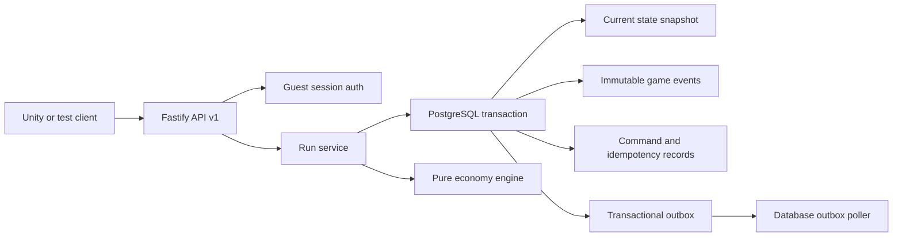

# Trap Wars V2 Backend Architecture

Status: M6 implemented foundation
Date: 2026-08-11

## Runtime shape

M6 is one deployable TypeScript modular monolith in `apps/api`. Fastify owns HTTP concerns, Drizzle owns typed PostgreSQL access, and `@trap-wars/economy-engine` remains a pure package with no database, HTTP, auth, clock, or environment dependency.



The trust rule is: clients submit intentions; the API authenticates and authorizes them; the engine decides legality and outcomes; PostgreSQL commits the result atomically.

## Module boundaries

| Module | Responsibility |
| --- | --- |
| `auth` | Guest player, identity, opaque session issuance, bearer authentication |
| `runs` | Request schemas, ownership, transaction orchestration, replay, safe projection |
| `database` | Drizzle schema, node-postgres pool, ordered SQL migration runner |
| `outbox` | Claim, retry, recover, and publish committed integration events |
| `http` | Normalized errors, body limit, request IDs, local rate limiting |
| `infrastructure` | Cryptographic tokens, request hashes, AES-256-GCM run-seed protection |

## Authoritative transaction

For a gameplay command, the service:

1. Authenticates the bearer session before entering the service.
2. Begins a PostgreSQL transaction and locks the run row with `FOR UPDATE`.
3. Conceals missing and foreign-owned runs behind `RUN_NOT_FOUND`.
4. Resolves durable idempotency before checking the expected version.
5. Loads the current snapshot and rejects a stale version with a safe reconciliation projection.
6. Decrypts the protected seed only in server memory and calls the pure engine.
7. For an accepted result, appends events and outbox rows, updates the snapshot/run, and writes command/idempotency responses.
8. Commits once and returns the safe projection. Any failure rolls back all writes.

Domain rejections return `422` and do not write command, event, state, idempotency, or outbox records.

## Randomness and replay

Each run has a 32-byte random seed generated by the API and encrypted at rest with AES-256-GCM. The API stores the engine's deterministic events, including internal evidence required to reproduce decisions, but strips seed identifiers and forecast internals from client responses. Ordered `game_events.event_payload` records replay to the exact stored `EconomyState` in integration tests.

## Outbox delivery

The poller claims pending rows using `FOR UPDATE SKIP LOCKED`, marks them processing, publishes outside the claim transaction, and then marks them published. Failed rows use bounded exponential retry. Processing rows older than five minutes are returned to pending. The M6 CLI publisher emits structured JSON; a production analytics destination is deferred.

## Local operation

```powershell
docker compose up -d postgres
Copy-Item .env.example .env
npm run db:migrate
npm run api:dev
```

Run the worker separately with `npm run outbox:poll`. For a disposable local reset, stop the application, run `docker compose down -v`, start PostgreSQL again, and rerun migrations. No data seed is required because guest auth and run creation initialize their own records.

## Locked M5.6 decisions

- Aggressive downside is `ACCEPTED_FOR_V2_FOUNDATION` and remains a monitoring item.
- Information-Aware performance at approximately 63.7% of Opportunist median is accepted.
- Later-city dependence is `CONTENT_DESIGN_FOLLOWUP`, not an M6 backend blocker.
- Persistent Heat is `DEFERRED_GAMEPLAY_SYSTEM` and is not present in M6 state.

## Production gates

Replace the single-process rate limiter with a shared edge or distributed policy before horizontal scale. Run migration, concurrency, backup/restore, and load tests against the selected managed PostgreSQL service. Add session rotation/revocation UI, account linking, secret-manager integration, outbox destination guarantees, metrics, and retention policies before public production.
