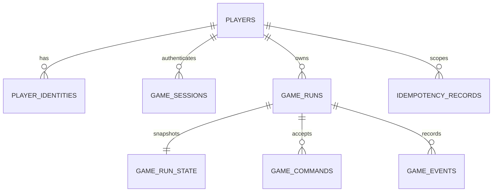

# Trap Wars M6 Database Schema

PostgreSQL is the authoritative store. Migration `apps/api/migrations/0001_m6_authoritative_runtime.sql` creates the schema from an empty database; `npm run db:migrate` applies ordered migrations and records them in `schema_migrations`.

Drizzle was selected because it provides maintained TypeScript mappings while leaving the SQL migration, locks, constraints, and transaction boundary visible. Economy-critical behavior is explicit in `RunService`, not hidden in lifecycle hooks.

## Tables

| Table | Purpose and key constraints |
| --- | --- |
| `players` | Internal chain-agnostic player UUID and lifecycle status |
| `player_identities` | Provider links; unique `(provider, provider_subject)` |
| `game_sessions` | Opaque session token hashes, expiry, revocation, last seen |
| `game_runs` | Owner, run lifecycle, encrypted seed fields, pinned versions, next event sequence |
| `game_run_state` | One current JSONB `EconomyState` snapshot and state version per run |
| `game_commands` | Accepted command ledger, server-only random evidence, and durable response; unique `(run_id, command_id)` |
| `game_events` | Immutable ordered event stream; primary key `(run_id, sequence)`, unique event ID per run |
| `outbox_events` | Transactional integration queue with claim/retry/publication status |
| `idempotency_records` | Scoped durable request hash and response; primary key `(player_id, scope, idempotency_key)` |

## Relationships

`outbox_events.aggregate_id` refers to the game run at the application boundary. It intentionally has no foreign key so published integration history is not coupled to aggregate deletion policy.

## Economy invariants

- A command ID can commit once per run.
- Event sequence is monotonic per run and assigned from the locked `game_runs.next_event_sequence`.
- The command record, events, snapshot, run metadata, outbox rows, and idempotency response share one transaction.
- Historical `game_events` are append-only in application code.
- The snapshot avoids replay on the hot command path; the event stream remains replayable evidence.
- Every event row pins economy, content, balance, and random-strategy versions.
- Every accepted command stores the engine's random evidence for server-side outcome audit; this field is never projected to clients.
- Run seed ciphertext, IV, and authentication tag are stored separately. The encryption key is environment-secret material and is never stored in the database.

## Identity model

`players.player_id` is the platform identity. `player_identities.provider` permits `GUEST`, `EMAIL`, `SOCIAL`, `BASE_ACCOUNT`, `EXTERNAL_WALLET`, and `TELEGRAM_LEGACY`. M6 creates only `GUEST`; the other values reserve a chain-agnostic linking path. No wallet private key field exists.

## Idempotency scopes

- Run creation: `create_run`, serialized by locking the player row.
- Gameplay command: `run_command:{runId}`, serialized by locking the run row.
- `request_hash` detects key reuse with a different request.
- Accepted responses are stored as JSONB and returned as the same JSON value on retry.

Records currently expire with the session TTL. Production retention must be set longer than every supported client retry/offline window, with cleanup performed outside command transactions.

## Outbox lifecycle

Valid status values are `PENDING`, `PROCESSING`, `PUBLISHED`, and `FAILED`. Claims use `FOR UPDATE SKIP LOCKED`; retries update `attempts`, `available_at`, and `last_error`. Published rows are retained until an explicit operational retention policy exists.
