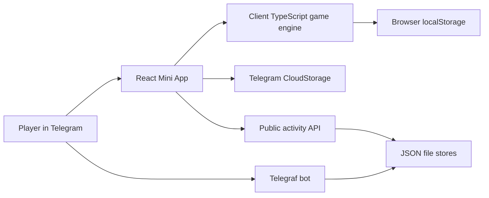

# Trap Wars V2 Repository Audit

Status: M0 blueprint
Audit date: 2026-08-11
Primary gameplay source: `WTFINATRUCK/trap-war`
Historical reference: `WTFINATRUCK/trap-wars`

## 1. Scope and guardrails

This audit records the current state before V2 production work begins. It does not authorize migration.

- Both repositories remain intact on their existing `main` branches.
- No current source file is moved, renamed, deleted, or reorganized in M0-M4.
- `trap-war` is the source of truth for implemented gameplay.
- `trap-wars` is historical evidence for Solana, wallet, leaderboard, vault, reward, and architecture ideas only.
- Financial contracts, production infrastructure, and Unity implementation are outside this phase.
- Facts about working code are kept separate from product proposals.

## 2. Executive finding

`trap-war` is a coherent mobile prototype, not a production game backend. It contains a surprisingly substantial 30-day economy loop in a single client-side TypeScript engine, plus Telegram identity, local/Telegram cloud saves, a Telegraf bot, a small public activity API, and file-backed referral/user records. The playable economy is entirely client-authoritative and uses `Math.random()`, so balances, outcomes, referrals, and career statistics are not suitable for competitive or real-value use.

`trap-wars` is an earlier Next.js/Solana experiment. Its strongest value is as a record of product intent: wallet-gated play, market-linked pricing, a vault, an authority-updated leaderboard, zone ownership, and reward/referral concepts. Its token mint is a placeholder, two Anchor program IDs are mock strings, unstaking is incomplete, and several admin/bot concepts are unsafe or unsuitable for V2. It must not define current product direction.

The safest extraction path is to document and characterize the current engine first, then build a deterministic server-capable economy package beside the existing app. The existing Telegram game should remain available as a reference and balance oracle until parity tests pass.

## 3. Repository inventory

| Repository | Current role | Stack | Verified state | V2 disposition |
| --- | --- | --- | --- | --- |
| `WTFINATRUCK/trap-war` | Primary gameplay implementation | Vite, React 18, TypeScript, Telegraf, Vercel functions | `npm install` and `npm run build` completed; 90 tracked files; no automated tests found | Preserve intact; extract mechanics and scenarios; candidate future V2 monorepo only after approval |
| `WTFINATRUCK/trap-wars` | Historical web3 prototype | Next.js 15, React 18, Solana wallet adapter, Anchor, Jupiter | Dependency installation did not complete within the audit window; no clean build established | Preserve intact as reference; do not port Solana assumptions into V2 |

Audited revisions:

- `trap-war`: `6b3592b7275e691eb2bcc4cc288af390db6c0b6d`, dated 2026-07-26.
- `trap-wars`: `08370049f02c78dbbc43060001047503363a312d`, dated 2025-11-29.

No Unity project, `ProjectSettings`, or Unity package manifest exists in either current product path.

## 4. Current `trap-war` architecture

### 4.1 Client application

- `src/App.tsx` gates the game behind a Telegram user in production and exposes `HUSTLE`, `CREW`, and `VAULT` tabs.
- `src/components/TrapWarGame.tsx` owns the interactive flow and many side effects: game actions, save calls, messages, activity events, audio, referral drip, completion bonus, and career counters.
- `src/components/TrapPhone.tsx` presents messages, market, clients, travel, news, contacts, upgrades, gang, and settings. Several views are informational mockups rather than complete systems.
- `src/components/CrewPanel.tsx` displays invite and referral information.
- `src/components/VaultPanel.tsx` explicitly marks wallet, NFT, protected vault, and pay-to-earn surfaces as simulations or previews.
- `src/lib/game/activityFeed.ts` combines local player events, deterministic synthetic city pulse, named NPC stories, optional remote activity, and public player cards.

### 4.2 Gameplay engine

- `src/lib/game/engine.ts` contains initialization, save migration, valuation, ranks, buy/sell, stashes, clients, travel, day advancement, yield, robbery, raids, random encounters, transport, intel, boosts, and run completion.
- `src/lib/game/constants.ts` contains the current balance sheet: cities, adjacency, products, gear, ranges, yields, availability, ranks, client gates, city biases, and encounter labels.
- `src/lib/game/types.ts` defines the complete per-run state.
- The engine is framework-light and therefore a strong specification source, but it is not deterministic because randomness is read directly from `Math.random()`.
- Several helpers mutate nested state and several UI handlers own economic side effects. Extraction cannot be a file copy.

### 4.3 Identity and saves

- `src/hooks/useTelegram.ts` reads Telegram Mini App identity and allows a local development identity only outside production.
- Browser entry to the production game requires Telegram initialization data, but the playable economy itself is not authenticated with an authoritative service.
- `src/hooks/useCloudSave.ts` prefers Telegram `CloudStorage` key `game_v1`, falls back to `localStorage`, and times cloud operations out after 1.5 seconds.
- The local key is `trapwar_cloud_{telegramId}`.
- Full run state, referral display fields, run count, best score, and an optional wallet address are stored as client-controlled JSON.
- Save migration remaps earlier asset names and older single-product city stashes into the current shape.

### 4.4 Bot and public API

- The Telegraf bot supports launch/setup, community, guard, user, referral, and admin workflows.
- Server-side Telegram `initData` HMAC validation, timing-safe hash comparison, age validation, basic sanitization, and in-memory rate limiting exist.
- `/api/me` and `/api/invites/count` validate Telegram initialization data when a bot token is configured.
- `/api/activity`, `/api/player`, `/api/stats`, and health routes support the Street Wire and public data.
- Users, referrals, and activity are persisted to JSON files. User and referral writes use temporary-file renames; activity writes are simpler direct file writes.
- In-memory rate limits reset per process and do not coordinate across serverless instances.
- The API does not receive or validate buy, sell, stash, travel, yield, score, or completion commands.

### 4.5 Deployment model

- The Mini App is intended for Vercel and an HTTPS domain.
- Bot processes require a persistent host unless webhook functions are used.
- API bundles are generated CommonJS artifacts committed under `api/`.
- The current build regenerates those bundles. The audit run left four generated bundle paths marked modified because of line-ending/index behavior; no source changes were made to them and they are not part of the approved deliverables.

## 5. Current `trap-wars` historical architecture

- `components/DopeWarsGame.tsx` is a separate 30-day, wallet-keyed, localStorage game with a `$50,000` starting balance, six products, random travel events, and rank multipliers tied to a simulated staked amount.
- `lib/marketData.ts` reads SOL pricing from Jupiter and token liquidity/volume from DexScreener, then applies a capped `0.5x-5.0x` multiplier to game prices.
- `lib/tokenUtils.ts` contains Solana transfer and Jupiter swap helpers, but the `$TRAP` mint defaults to a placeholder and the RPC is hard-coded to Solana mainnet.
- `lib/referralUtils.ts` implements wallet-derived referral codes and a `0.5%` localStorage reward after a `$100` simulated stake threshold. Discovery scans browser storage and is not authoritative.
- `programs/trap_vault` accepts stakes but does not implement the signed token transfer required to unstake. Its program ID is a mock string.
- `programs/trap_leaderboard` lets a configured authority update player scores. This is useful architectural precedent for server-authoritative results, not reusable contract code.
- `programs/trap_zones` implements minimal attack/defense ownership with a mock program ID and no meaningful economic controls.
- Admin code includes simulated volume and grid trading bot concepts. These are not approved V2 features and must not be carried forward without legal, ethical, security, and market-integrity review.

## 6. Reuse classification

| Area | Classification | Reason and action |
| --- | --- | --- |
| Current constants, state fields, and formulas | Extract as specification | Preserve behavior in characterization fixtures before redesign |
| Buy/sell/stash/travel/client/rank concepts | V2 candidate | Strong core loop; move into versioned server-capable rules |
| Telegram Mini App UI | Reference implementation | Useful workflow evidence; not the premium 3D target |
| Telegram bot and community guard | Optional legacy channel | Can remain a distribution/community adapter after V2 identity is independent |
| Save migration logic | Reference and fixture source | Use old save examples to define import policy; do not trust imported balances |
| Activity feed and named NPCs | V2 candidate with rewrite | Preserve tone and contact roles; separate synthetic, NPC, and real-player events |
| Client referral calculations | Reject for authoritative use | Spoofable and local-only; retain values as product hypotheses |
| JSON file persistence | Reject for V2 source of truth | Cannot provide durable concurrency, transactions, or horizontal scaling |
| Solana wallet/swap utilities | Legacy | Base is the approved chain direction |
| Anchor vault, zone, leaderboard programs | Legacy design evidence | Placeholder/incomplete contracts; no deployment or direct port |
| Market-linked price multiplier | Research candidate | Could create educational scenarios, but requires bounded oracle and manipulation design |
| Founder NFT and pay-to-earn UI | Designed, not implemented | Do not build or market as live economics during the vertical slice |

## 7. Security and integrity findings

### Critical product-integrity gaps

1. The browser owns all important game state and can directly alter cash, inventory, yields, rank, score, completion, referrals, and wallet linkage.
2. Random results use `Math.random()` with no seed, audit trail, replay capability, or server commitment.
3. Saves are accepted from Telegram CloudStorage or localStorage without server-side validation.
4. Referral earnings are calculated and stored on the client while bot-side referral attribution is stored separately. There is no authoritative settlement or claim ledger.
5. Game actions have no idempotency key, version check, transaction boundary, or anti-replay protection.

### Platform and service gaps

- JSON file stores are vulnerable to instance-local divergence and are unsuitable for serverless horizontal scaling.
- Rate limiting is process-local.
- Public activity is not a trusted gameplay record and must never feed rewards or rankings.
- Telegram identity is coupled to product entry; no platform-independent player identity exists.
- No audit log connects an action request to a ruleset version, random seed, state transition, and response.
- No automated tests were found in `trap-war`.
- No secret file is tracked; `.env.example` is tracked and source references expected environment variable names. This is not proof that deployed secrets are correctly managed.

### Dependency audit

`npm audit --json` on 2026-08-11 reported 13 vulnerabilities in `trap-war`: 10 high, 3 moderate, 0 critical. Direct affected packages include `@vercel/node` and `postcss`; transitive findings include `@vercel/build-utils`, `@vercel/python-analysis`, `@vercel/static-config`, `ajv`, `brace-expansion`, `js-yaml`, `minimatch`, `nanoid`, `path-to-regexp`, `smol-toml`, and `undici`.

Most findings are in build/server tooling dependency chains. Per the approved directive, remediation priority is:

1. Immediately assess any currently public API or bot path exposed through a vulnerable runtime dependency.
2. Patch a vulnerability if it threatens extraction work, secrets, or user data.
3. Do not spend a major modernization cycle on the obsolete Telegram stack solely to make the audit report clean.
4. Begin V2 on maintained, pinned dependencies with automated update and vulnerability scanning.

## 8. Build and test evidence

| Check | Result |
| --- | --- |
| `trap-war` install | Completed; 261 packages added in audit environment |
| `trap-war` TypeScript/Vite build | Passed |
| Bot/serverless bundle generation | Passed |
| `trap-war` automated tests | None found |
| `trap-wars` install/build | Not established; install exceeded the audit time window and was stopped |
| Unity project | Not present |

The passing `trap-war` build proves compilation, not gameplay correctness, security, determinism, or balance.

## 9. Required extraction sequence

1. Freeze this audit and the current-implementation GDD as source evidence.
2. Create characterization scenarios for initial state, prices, cash skim, ranks, travel, stashes, clients, yield, robbery, raids, encounters, and completion.
3. Define deterministic random interfaces and fixed-point money rules.
4. Implement `packages/economy-engine` beside the current app without moving current files.
5. Run old-engine versus new-engine fixture comparisons for intended parity.
6. Document every intentional behavior change as a new ruleset version.
7. Build the authoritative API and PostgreSQL persistence before Unity can affect meaningful balances.
8. Revisit monorepo migration only after M0-M5 documents and extraction are approved.

## 10. Decision register

Accepted now:

- PostgreSQL is the default V2 source of truth.
- Unity and browsers submit intentions; neither owns authoritative economic state.
- A stable Trap Wars player ID is independent of Telegram and wallets.
- Base work begins with account onboarding on testnet, not financial contracts.
- Analytics taxonomy precedes serious greybox testing.
- Early web scope is limited to launch, identity, profile, a leaderboard placeholder, and company/investor content.

Deferred:

- Token, marketplace, vault, rewards, NFT/asset ownership, and achievement contract architecture.
- Real-money flows, custody model, jurisdictional eligibility, and reward settlement.
- Final product naming/content treatment for illicit-market references.
- Final hosting vendor, identity provider, wallet provider, analytics vendor, and Unity distribution mix.

## 11. Unresolved risks

- The premium 3D scope can outrun economy, backend, and content proof if the slice is not tightly bounded.
- Drug-market language plus financial education and future rewards may create platform, advertising, age-rating, banking, and regulatory constraints.
- WebGL quality, memory, shader compilation, and download size may conflict with premium presentation.
- Current balance behavior includes hidden coupling and UI-owned effects; extraction may reveal additional accidental rules.
- A wallet-first onboarding step could harm conversion; onboarding must be measured and optional until a player reaches clear value.
- Any public deployment of the current prototype keeps client-integrity and dependency risks alive even if V2 work is isolated.

## 12. Evidence map

Primary gameplay evidence:

- `src/lib/game/constants.ts`
- `src/lib/game/types.ts`
- `src/lib/game/engine.ts`
- `src/components/TrapWarGame.tsx`
- `src/components/TrapPhone.tsx`
- `src/components/CrewPanel.tsx`
- `src/components/VaultPanel.tsx`
- `src/hooks/useTelegram.ts`
- `src/hooks/useCloudSave.ts`
- `src/lib/referral.ts`
- `src/lib/game/referralDrip.ts`
- `src/lib/game/activityFeed.ts`
- `bot/publicApi.ts`
- `bot/security.ts`
- `bot/users.ts`
- `bot/referrals.ts`
- `bot/activity.ts`

Historical evidence:

- `components/DopeWarsGame.tsx`
- `lib/marketData.ts`
- `lib/referralUtils.ts`
- `lib/tokenUtils.ts`
- `programs/trap_vault/src/lib.rs`
- `programs/trap_leaderboard/src/lib.rs`
- `programs/trap_zones/src/lib.rs`

