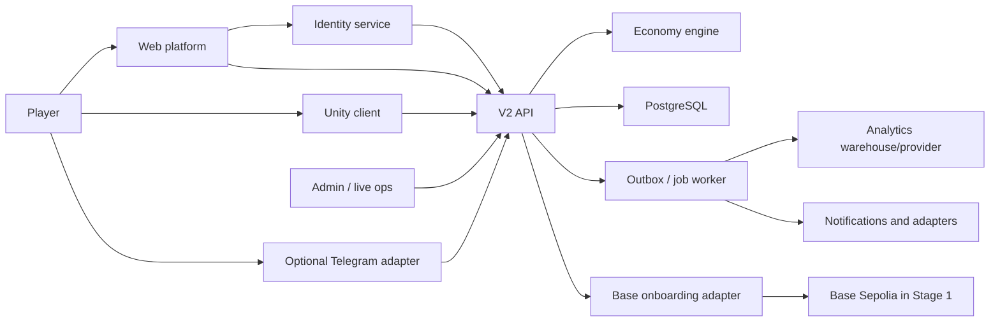
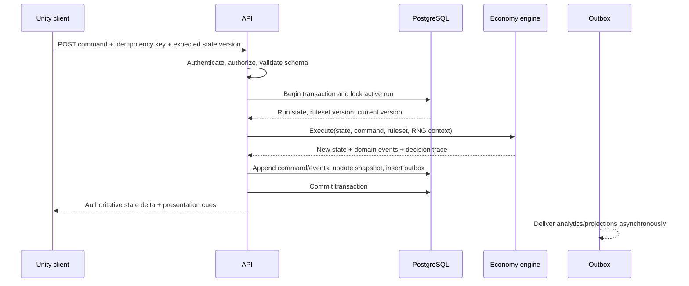

# Trap Wars V2 Technical Architecture

Status: M6 authoritative backend implemented; M7 pending review
Date: 2026-08-11
Decision scope: product foundation through premium vertical slice

## 1. Architecture outcome

Trap Wars V2 will use Unity as the playable 3D client, a server-authoritative TypeScript economy engine, a transactional API backed by PostgreSQL, and a small web platform for identity, profile, launch, and company/investor needs. Telegram becomes an optional linked identity and distribution adapter. Base integration begins with low-friction account onboarding on Base Sepolia; token, marketplace, vault, reward, and ownership contracts remain deferred.

The core trust rule is simple:

> A client may request an action and render a result. Only the backend may commit meaningful economic state.

## 2. Architecture principles

1. **Server authority**: Unity, web, Telegram, and local saves are never authoritative for balances, inventory, score, progression, referrals, or competitive outcomes.
2. **Deterministic simulation**: the economy engine accepts explicit state, command, ruleset, clock, and random source and returns a result without hidden I/O.
3. **Versioned behavior**: every run is pinned to a ruleset version. Balance changes never rewrite an active run silently.
4. **Replayability**: accepted commands and random decisions can reconstruct or audit state transitions.
5. **Identity separation**: Trap Wars player identity is independent of login provider, Telegram ID, device, and wallet address.
6. **Game before chain**: a player can begin and complete the learning loop without seed phrases, gas, RPCs, bridges, or EVM vocabulary.
7. **Onchain minimalism**: Stage 1 proves account creation/linking and sponsored testnet interaction; Stage 2 economics waits for gameplay evidence and specialist review.
8. **Measured learning**: analytics are designed before greybox tests, including educational reveals and player outcomes.
9. **Small early web surface**: launch, authentication, profile, game entry, leaderboard placeholder, and company/investor content only.
10. **Operational reversibility**: live-ops config is validated, versioned, auditable, and rollback-capable.

## 3. System context



## 4. Target repository shape

This is a target, not an instruction to move files during M0-M4.

```text
trap-war/
  apps/
    web/                    # public platform, auth, profile, launch
    api/                    # authenticated command/query API
    worker/                 # outbox delivery, projections, scheduled jobs
    admin/                  # minimal internal live-ops and support UI
  game/
    unity/                  # Unity client and content
  packages/
    economy-engine/         # deterministic rules and state transitions
    game-data/              # versioned authored definitions and validation
    shared-types/           # API schemas and generated contracts
    analytics/              # event schema, validation, destinations
    base-sdk/               # Base account provider abstraction
  contracts/
    identity/               # Stage 1 only if a custom contract is proven necessary
    achievements/           # deferred Stage 2
    rewards/                # deferred Stage 2
    marketplace/            # deferred Stage 2
    vault/                  # deferred Stage 2
  docs/
  infrastructure/
  legacy/                   # created only after migration approval
```

No `contracts/*` financial implementation is required for the vertical-slice foundation.

## 5. Component responsibilities

| Component | Owns | Must not own |
| --- | --- | --- |
| Unity client | Input, movement, camera, presentation, dialogue, local prediction, request UI, result animation | Authoritative cash, inventory, score, event outcome, referral reward |
| Web platform | Account entry, profile, game launch, investor/company pages, placeholder leaderboard | Independent economy logic or alternate balance source |
| API | Authentication, authorization, validation, transactions, idempotency, command orchestration, queries | Hidden balance formulas duplicated outside economy engine |
| Economy engine | Pure rules, command validation, calculations, deterministic random decisions, domain events | Database, network, analytics SDK, current wall clock, wallet SDK |
| PostgreSQL | Durable source of truth, constraints, command ledger, snapshots, outbox | Presentation-specific state |
| Worker | Outbox delivery, projections, analytics forwarding, notifications, scheduled non-interactive jobs | Direct balance mutation outside commands |
| Identity service | Login sessions and verified provider identities | Wallet custody or economic state |
| Base adapter | Smart-account linking/provisioning, testnet transaction orchestration, sponsorship policy | Core player identity or game-balance truth |
| Admin/live ops | Ruleset publishing, support actions, flags, content scheduling, audit views | Unlogged arbitrary database edits |

## 6. Authoritative action flow



Required request fields:

- `commandId`: globally unique idempotency key generated by the client.
- `runId`: active run identifier.
- `expectedVersion`: last authoritative version observed by the client.
- `type`: versioned command type such as `market.trade` or `travel.begin`.
- `payload`: schema-validated intention, never a resulting balance.
- `clientContext`: build version, platform, locale, and correlation ID; no trusted economics.

Required response fields:

- `accepted`, `commandId`, `runId`, and new `stateVersion`.
- Minimal authoritative state delta or refreshed snapshot.
- Domain events with stable IDs.
- Presentation cues that help Unity stage consequences without recomputing them.
- Structured rejection code for stale state, insufficient funds, invalid target, cooldown, or policy failure.

## 7. Economy engine design

### 7.1 Package contract

The engine is a pure package that can run in API tests, simulations, balance tools, and migration validation.

```ts
type ExecuteInput = {
  state: EconomyState;
  command: EconomyCommand;
  rules: Ruleset;
  random: RandomSource;
  effectiveAt: number;
};

type ExecuteOutput = {
  state: EconomyState;
  events: DomainEvent[];
  decisions: DecisionRecord[];
};

function execute(input: ExecuteInput): ExecuteOutput;
```

No function inside the package may read `Date.now()`, `Math.random()`, environment variables, a database, localStorage, network APIs, or Unity state.

### 7.2 Numeric model

- Represent currency and token-like quantities as integers in named minor units.
- Represent rates as integer basis points or an explicit fixed-point type.
- Define rounding mode per operation; default to floor only where the current baseline intentionally floors.
- Reject `NaN`, floating-point infinity, negative quantities, and integer overflow at boundaries.
- Keep simulated game cash in a separate type from any future real or onchain asset amount.

### 7.3 Random model

- Use a cryptographically strong, reproducible seeded PRNG interface for server simulation.
- Derive per-command random streams from a protected run seed plus command sequence/context.
- Store enough decision evidence to replay outcomes without exposing future random values to clients.
- Never accept a random roll, event result, or seed chosen by Unity.
- Use authored scenario IDs for the investor slice where narrative timing matters; random variation can exist inside bounded scenario rules.

### 7.4 Rulesets and game data

- Every run stores `economy_version`, `content_version`, `balance_version`, and `random_strategy_version` in durable state. API DTOs may expose equivalent camelCase fields, but persisted and analytics contracts use the canonical names.
- Rulesets are immutable after publication.
- Draft rulesets are schema-validated and simulated before activation.
- Balance tools compare expected-value distributions and current-prototype fixtures.
- Existing values are imported as a `legacy-telegram-v1` reference ruleset, not declared final V2 balance.
- Unity receives presentation-safe game data; server-only weights and anti-exploit controls remain private when needed.

### 7.5 Content system

Game content must be data-driven before Unity production scales. MonoBehaviours may present or bind content, but they must not become the only definition of cities, NPCs, dialogue, rumors, products, prices, market events, missions, education reveals, ranks, rewards, progression, or environmental events.

Content domains:

- Locations: cities, neighborhoods, zones, travel edges, safehouses, spawn points, and environment-set references.
- Characters: NPC identity, role, availability, relationship gates, dialogue graph, voice/animation tags, and presentation references.
- Economy-facing content: products/assets, market definitions, price bands, event modifiers, capacity rules, and reward references.
- Narrative/gameplay: rumors, missions, objectives, dialogue, consequences, progression gates, ranks, and environmental events.
- Education: concept IDs, experiential trigger, reveal copy, evidence fields, optional explanation, reinforcement opportunities, and localization.

Authoring and runtime requirements:

1. Definitions use stable opaque IDs. Display names and city-specific language are localized data, not identifiers.
2. `VERTICAL_SLICE_CITY_TBD` remains a replaceable location definition until the city-selection gate is approved.
3. Schemas validate required fields, references, numeric ranges, localization keys, and client/server visibility.
4. Published content bundles are immutable and carry `content_version`; balance-only changes carry `balance_version`; executable economy behavior carries `economy_version`.
5. Server and Unity builds resolve the same content IDs. The API rejects a command when the required content/rules version is unavailable or incompatible.
6. Authoritative fields, hidden probabilities, anti-abuse controls, and reward conditions remain server-only. Unity receives presentation-safe projections.
7. Dialogue and education content support localization, accessibility metadata, review status, and provenance.
8. Content promotion follows draft -> validated -> staged -> published -> retired, with approvals and rollback to a previously published version.
9. Saved runs retain their original versions. A migration is an explicit command/process, never an implicit effect of publishing new content.
10. CI will validate content references, deterministic scenario fixtures, unsupported Unity assets, bundle size, and backward compatibility before publication.

Suggested conceptual definition:

```json
{
  "content_id": "location.vertical_slice_city_tbd.home_block",
  "content_type": "neighborhood",
  "content_version": "content-2026.08.1",
  "economy_version": "economy-legacy-baseline.1",
  "balance_version": "balance-slice.1",
  "client_payload": {},
  "server_payload": {},
  "localization_namespace": "location.vertical_slice_city_tbd"
}
```

The concrete storage and authoring tool are M6-M7 decisions. JSON/JSON Schema or an equivalent typed source format is preferred for reviewability and generation; Unity ScriptableObjects may be generated build artifacts rather than the canonical source.

### 7.6 Domain commands

Initial command vocabulary:

- `run.start`
- `market.view`
- `market.trade.request`
- `stash.deposit`
- `stash.withdraw`
- `travel.begin`
- `travel.arrive`
- `npc.interact`
- `rumor.acknowledge`
- `day.advance`
- `education.reveal`
- `account.linkWallet`

The vertical slice should avoid a generic client command that can patch arbitrary state.

### 7.7 Domain events

Initial event vocabulary:

- `run.started`
- `market.snapshot_viewed`
- `market.trade_completed`
- `market.trade_rejected`
- `economy.inventory_changed`
- `economy.balance_changed`
- `economy.stash_changed`
- `rumor.received`
- `market.condition_changed`
- `risk.resolved`
- `day.completed`
- `education.reveal_shown`
- `progression.changed`
- `run.completed`
- `wallet.link_verified`

Domain events describe facts and can feed analytics, but analytics delivery must not block the command transaction.

## 8. API architecture

### 8.1 Technology baseline

- Node.js with current pinned LTS runtime.
- TypeScript to share schemas and execute the economy package directly.
- Fastify 5 with Zod runtime schemas and normalized JSON errors.
- The M6 contract is documented manually; OpenAPI and generated C# DTOs remain an M7 integration task.
- Drizzle over node-postgres with explicit SQL migrations, transactions, constraints, and row locks.
- WebSocket or server-sent events only where asynchronous world updates prove necessary; core commands remain request/response.

The exact framework and ORM are implementation decisions for M6, not reasons to delay schema and command design.

### 8.2 API surface for the slice

```text
POST /api/v1/auth/guest
POST /api/v1/runs
GET  /api/v1/runs/{runId}
POST /api/v1/runs/{runId}/commands
GET  /health
GET  /ready
```

These are the implemented M6 endpoints. Account linking, public event cursors, game-data delivery, wallet linking, and leaderboards remain deferred. Use one command endpoint for atomic game intentions; add specialized endpoints only when caching, authorization, upload, or protocol semantics differ materially.

### 8.3 Concurrency and idempotency

- Unique constraint on `(player_id, command_id)` or globally unique `command_id`.
- Compare `expectedVersion` to the active run version.
- Lock the run row during transition or use optimistic update with an affected-row check.
- Return the original committed response for an idempotent retry.
- Never run analytics, email, Telegram, or chain calls inside the database transaction.
- Insert an outbox record in the same transaction as the state update.
- Use short-lived server-issued interaction tokens only where proximity or world interaction needs additional proof; do not pretend client position is unforgeable.

## 9. Data architecture

PostgreSQL is the default persistent store.

### 9.1 Core entities

The implemented M6 schema is authoritative and documented in `DATABASE_SCHEMA.md`. Earlier target-only entities such as wallet links, referrals, admin audit, queryable inventory projections, and ruleset catalogs remain deferred.

| Entity | Purpose |
| --- | --- |
| `players` | Stable Trap Wars identity and lifecycle status |
| `player_identities` | Provider identities linked to the internal player |
| `game_sessions` | Hashed opaque bearer sessions with expiry/revocation |
| `game_runs` | Run owner, status, encrypted seed, pinned versions, event cursor |
| `game_run_state` | Current authoritative economy snapshot |
| `game_commands` | Accepted command ledger, random evidence, durable response |
| `game_events` | Ordered immutable domain events for audit and replay |
| `outbox_events` | Transactional delivery queue for downstream projections |
| `idempotency_records` | Scoped request hashes and committed responses |

### 9.2 Storage policy

- PostgreSQL is the source of truth for player and economy state.
- Object storage/CDN holds Unity builds, asset bundles, media, and large exports.
- Redis is optional for caching, distributed rate limiting, short leases, and ephemeral presence. It is never the only copy of economic state.
- Analytics storage is a projection. It cannot be used to reconstruct balances without domain records.
- Personally identifiable data is minimized, encrypted where appropriate, and separated from public profile fields.
- Define deletion, retention, export, and age-gating policy before public scale.

## 10. Authentication and identity

### 10.1 Player identity model

`playerId` is a random platform ID. A player can link one or more identities:

- Email/social identity through an OIDC-capable provider.
- Telegram identity validated server-side.
- Base-compatible wallet proven by a signed challenge.
- Development/test identity in non-production environments only.

No external identifier becomes the database primary key. Wallet replacement, Telegram loss, or provider migration must not erase game history.

### 10.2 Session model

- Short-lived access token and rotated refresh session, preferably in secure HTTP-only cookies for web.
- Unity uses an authorization-code/device handoff or embedded browser flow, then stores refresh material in platform-secure storage where available.
- CSRF protection for cookie-authenticated mutations.
- Session revocation, device list, suspicious login signals, and account recovery support.
- Privileged admin identity is separate and requires MFA.

### 10.3 Account recovery

Recovery is a product flow, not a wallet-provider checkbox. Stage 1 must document:

- What restores the Trap Wars profile.
- What restores wallet control.
- What happens when email/social/Telegram access is lost.
- Whether a wallet can be exported or relinked.
- Cooling periods and notifications for sensitive identity changes.
- Support tooling that cannot seize a self-custodial wallet.

## 11. Base integration in two stages

### 11.1 Stage 1: player onboarding

Goals:

- Let the player start without a wallet decision.
- Offer account creation/linking only after the player has experienced product value.
- Hide seed phrases, gas, network switching, RPCs, and bridging from the normal path.
- Use Base Sepolia and valueless test assets only.
- Sponsor only allowlisted transactions with rate, budget, and abuse limits.
- Keep the wallet address linked to `playerId`, never use it as the player record.

Preferred prototype path:

1. Evaluate the Base Account SDK for passkey-based universal sign-in and its ERC-4337 smart-wallet model. Official Base documentation describes Base Accounts as smart-wallet-backed accounts using ERC-4337 and designed to avoid seed phrases and network switching: [Base Account overview](https://docs.base.org/base-account/overview/what-is-base-account).
2. Evaluate app-specific Sub Accounts only if the slice truly needs frequent onchain interactions. Base recommends paymaster sponsorship for that experience and documents spend-permission behavior: [Base Sub Accounts](https://docs.base.org/base-account/improve-ux/sub-accounts).
3. Compare Coinbase Developer Platform embedded non-custodial wallets when email, SMS, or social login is a stronger conversion requirement than passkey-first Base Account entry: [CDP non-custodial wallets](https://docs.cdp.coinbase.com/wallets/non-custodial-wallets/overview).
4. Use standard ERC-4337 infrastructure rather than writing a custom smart account during the slice. OpenZeppelin documents the account, EntryPoint, bundler, and paymaster roles: [OpenZeppelin account abstraction](https://docs.openzeppelin.com/contracts/5.x/account-abstraction).

Architecture decision for M8: implement a `WalletOnboardingProvider` interface and spike the preferred provider behind it. Do not integrate multiple production wallet stacks at once.

Stage 1 acceptance proof:

- A signed-in player can create or connect a smart account in a measured onboarding funnel.
- The backend can verify and link account ownership.
- A sponsored, allowlisted Base Sepolia transaction can complete without the player acquiring ETH.
- The player can skip or abandon wallet onboarding and continue the game.
- Recovery/export limitations are clearly documented before user testing.

### 11.2 Stage 2: economic infrastructure

Deferred until gameplay/economy approval:

- `$TRAP` design or issuance.
- Marketplace and asset ownership.
- Vault or yield-bearing structures.
- Reward distribution and eligibility.
- Achievement contracts beyond a testnet proof.
- Real-value referral settlement.
- Mainnet deployment.

Stage 2 requires threat modeling, economic simulation, legal/tax/regulatory review, contract audits, incident response, multisig/key management, pause/upgrade policy, and monitoring before deployment.

## 12. Web platform

### 12.1 Early scope

- Product/experience landing surface with the real playable product as the primary signal.
- Authentication and account recovery.
- Profile with progression summary and linked identities.
- Game launch and build/version compatibility checks.
- Leaderboard placeholder clearly labeled if not authoritative/live.
- Company and investor information.

### 12.2 Deferred scope

- Marketplace.
- Social network or extensive crew management.
- Complex portfolio dashboards.
- Consumer live-ops dashboard.
- Token/vault transaction center.
- Full admin suite before operations require it.

Use a current maintained React framework at M9. The web platform consumes the same API and generated schemas as Unity; it does not reimplement the economy.

## 13. Analytics foundation

M4 precedes serious greybox testing. [ANALYTICS_FOUNDATION.md](./ANALYTICS_FOUNDATION.md) is the authoritative event registry, ownership model, metric catalog, privacy baseline, ingestion contract, and dashboard requirement.

Architecture constraints:

- Canonical event naming is `domain.snake_case_action`.
- Unity and web emit only client observations through vendor-neutral interfaces.
- Server-authority analytics originates from committed domain events and the transactional outbox.
- Blockchain-authority events originate from verified chain normalization with finality/reorg handling.
- Every authoritative run event carries `economy_version`, `content_version`, `balance_version`, and `random_strategy_version`.
- Raw events remain immutable; sessions, funnels, daily metrics, learning evidence, and scorecards are rebuildable projections.
- Event IDs are stable across retries, and ingestion handles offline, delayed, duplicate, and reordered observations.
- No seed phrase, private key, auth secret, wallet secret, unredacted financial credential, or unnecessary PII enters analytics.
- Analytics delivery never blocks gameplay or an economic command.

## 14. Admin and live ops

Vertical-slice admin scope:

- Read player/run summaries in non-production and approved support contexts.
- Search by internal player ID; mask PII by default.
- Inspect command/event history and replay trace.
- Publish or roll back versioned content/rulesets through approval gates.
- Enable feature flags by environment or cohort.
- View economy and error guardrails.
- Record every privileged action with actor and reason.

No direct arbitrary balance editor is exposed. Any support correction is a typed, authorized compensating command with an audit event.

## 15. Environments and deployment

| Environment | Data | Chain | Purpose |
| --- | --- | --- | --- |
| Local | Seeded disposable database | Local mock or Base Sepolia sandbox | Development and deterministic tests |
| Dev | Shared non-sensitive fixtures | Base Sepolia | Team integration |
| Preview | Per-branch or per-build isolated data | Mock by default | Web/API review |
| Staging | Production-like synthetic accounts | Base Sepolia | End-to-end release candidate |
| Production | Real player profiles | No chain initially; explicit later approval | Public service |

Deployment shape:

- Containerized API and worker with health/readiness checks.
- Managed PostgreSQL with point-in-time recovery, encrypted backups, migrations, and restore drills.
- CDN/object storage for Unity builds and media.
- Web deployed independently from API and Unity build artifacts.
- Infrastructure as code only after the application boundaries stabilize; no production changes in M2.
- Separate secrets, projects/accounts, databases, and signing keys per environment.
- Mainnet and production sponsorship credentials do not exist during the foundation slice.

## 16. Security architecture

### 16.1 Threats to address

- Modified Unity/browser clients sending impossible commands.
- Replay, duplicate submission, race conditions, and stale-state exploitation.
- Economy overflow, rounding abuse, price/event prediction, and ruleset mismatch.
- Referral farming, self-referral, multi-account abuse, and synthetic activity confusion.
- Session theft, account-link takeover, and wallet-link substitution.
- Paymaster drain and unbounded sponsored operations.
- Admin credential compromise and unlogged support changes.
- Dependency, build-pipeline, asset-bundle, and supply-chain compromise.
- PII leakage through logs, analytics, crash reports, or public player cards.

### 16.2 Required controls

- Runtime schema validation on every trust boundary.
- Server recomputation of all economic results.
- Database constraints and transactional idempotency.
- Rate limits distributed by account, IP/risk signal, command type, and sponsorship budget.
- Signed wallet-link challenges with nonce, domain, chain, intent, and expiry.
- Least-privilege service accounts and short-lived cloud credentials.
- Secret manager; no secrets in Unity, web bundles, repositories, or analytics.
- MFA and role-based access for admin.
- Immutable admin and economy audit records.
- Dependency lockfiles, automated scanning, provenance/SBOM where practical, and protected release branches.
- Abuse simulations before referral or sponsored-transaction rollout.

## 17. Observability and operations

- Correlation ID from client command through API transaction, domain event, outbox, and analytics delivery.
- Structured logs with redaction and no gameplay secrets/PII by default.
- Metrics: command latency/error/rejection, database contention, stale-version rate, idempotent retry rate, outbox lag, ruleset distribution, economy source/sink totals, sponsorship spend/failures.
- Traces for API, database, worker, and Base provider calls.
- Alerts based on service-level objectives and economy anomalies, not raw log volume.
- Dead-letter handling and replay for outbox delivery.
- Runbook for database restore, provider outage, wallet-link outage, ruleset rollback, and disabling sponsorship.

## 18. Performance and scalability targets

- Economy engine command execution: target under 10 ms p95 in isolated benchmark for slice rules.
- Normal authenticated command API: target under 250 ms p95 excluding external chain settlement in the primary deployment region.
- State payloads are compact deltas plus occasional snapshots; avoid serializing the whole 3D world.
- Horizontal API scaling is safe because state lives in PostgreSQL and limits/idempotency are coordinated.
- World ambience and NPC motion remain client simulation unless they affect authoritative outcomes.
- Base transactions are asynchronous long-running operations with explicit pending/confirmed/failed state; they do not block normal gameplay.
- Load tests include duplicate commands, hot-run contention, reconnect storms, and outbox backlog.

## 19. Technical decisions

Accepted:

- Unity is the 3D client; it is never economy-authoritative.
- TypeScript is the first economy-engine language so current behavior can be characterized and shared with the API.
- PostgreSQL is the default durable store.
- Commands plus immutable domain events and snapshots provide audit/replay without requiring full event sourcing for every read.
- OpenAPI/runtime schemas define the Unity/API boundary.
- Base Sepolia only for Stage 1.
- Wallet onboarding is optional and linked to a platform identity.
- Redis is optional infrastructure, not a source of truth.

To decide by milestone:

- M4: analytics destination, consent model, event ownership, and dashboard set.
- M5: exact PRNG, fixed-point library, test framework, and ruleset format.
- M6 resolved: Fastify, Drizzle/node-postgres, and guest identity foundation. Hosting region and backup objectives remain production deployment decisions.
- M7 resolved: Unity `6000.3.20f1`, URP `17.3.0`, Input System `1.19.0`, ScriptableObject dialogue, Windows-first development with Web/mobile-aware boundaries. Addressables remain deferred until content scale justifies them.
- M8: Base Account versus CDP embedded wallet provider based on onboarding test evidence.

## 20. Migration gates

Repository migration may begin only when:

1. M0 audit, M1 GDD, M2 architecture, and M3 slice specification are approved.
2. M4 analytics taxonomy is approved.
3. M5 extraction plan includes current-engine characterization fixtures and deterministic interfaces.
4. Owners agree how `trap-war` and `trap-wars` history remains discoverable.
5. Generated bundle line-ending changes and any unrelated user changes are handled intentionally.
6. A rollback/recovery approach exists for each structural move.

Until then, new V2 packages may be designed on paper or added beside current code only with separate approval. No mass move is implied by this architecture.

## 21. Unresolved risks

- Whether desktop WebGL can deliver the required visual quality, load time, and memory ceiling on investor hardware.
- Whether the current illicit-market vocabulary is acceptable for target platforms, investors, partners, ratings, and jurisdictions.
- Whether future real-value rewards change the product's legal classification or age/identity requirements.
- Whether Base Account passkeys or embedded email/social wallets produce the best recovery and conversion outcome for this audience.
- How much positional validation is necessary when an offline-looking 3D interaction triggers server economic commands.
- Whether a single-region transactional service is sufficient for launch or multi-region reads are needed.
- How current Telegram players and non-economic career history could be imported without accepting forged balances.

## 22. M5 implementation record

The first approved economy boundary now exists at `packages/economy-engine`; see `ECONOMY_ENGINE_ARCHITECTURE.md`. It implements a pure command -> domain events -> reducer -> versioned state pipeline with optimistic concurrency, command idempotency, HMAC-SHA256 named random streams, replay evidence, legal-action projection, separate wealth/game scoring, legacy characterization tests, V2 invariant tests, and a five-agent headless simulator.

The M5 decisions resolve the earlier architecture placeholders as follows:

- PRNG: HMAC-SHA256 named streams with unbiased bounded integer mapping.
- Arithmetic: integer simulated dollars/units and basis points; no floating currency state.
- Test runner: Node test runner executed through `tsx`; deterministic seed search substitutes for a new property-testing dependency in this milestone.
- Ruleset: TypeScript definitions pinned by economy/content/balance/random versions.
- Terminal day, stash locality, gear valuation, forecast uncertainty, client gates, raid locality, zero-action escape, and robbery accounting follow the approved M5 divergence table.

This record authorized the now-completed M6 API/database adapter. It does not authorize Unity, Base, production deployment, or broad repository migration work.

## 23. M6 implementation record

M6 implements the authoritative modular monolith in `apps/api`; detailed contracts are in `BACKEND_ARCHITECTURE.md`, `API_CONTRACT_V1.md`, `DATABASE_SCHEMA.md`, and `UNITY_CLIENT_CONTRACT.md`.

Resolved decisions:

- HTTP framework: Fastify 5 with a 32 KiB body limit, normalized errors, request IDs, structured logs, health/readiness routes, and a simple local rate limiter.
- Database layer: Drizzle ORM over node-postgres, selected for typed mappings with explicit SQL migrations, transactions, constraints, and row locks.
- Source of truth: PostgreSQL tables for players, provider identities, guest sessions, runs, current snapshots, accepted commands, immutable events, transactional outbox, and idempotency responses.
- Authentication: opaque guest bearer sessions are the minimum M6 implementation. The player remains independent of any Telegram, email, social, Base, or external-wallet identity.
- Command authority: `POST /api/v1/runs/{runId}/commands` locks the run, checks durable idempotency and expected state version, calls the pure M5.6 engine, and atomically commits events/state/outbox/response.
- Random protection: API-generated run seeds are encrypted at rest with AES-256-GCM and never enter public projections or logs.
- Delivery: an SQL-backed outbox poller uses `FOR UPDATE SKIP LOCKED`, stale-claim recovery, and bounded retries; no broker was introduced.

Integration tests use PGlite against the production SQL migration because Docker and `psql` were unavailable in the implementation environment. Native PostgreSQL migration, concurrency, restore, and load tests remain deployment gates. The measured warm PGlite development baseline is stored at `apps/api/test/performance-baseline.json`; it is evidence for regression comparison, not a production capacity claim.

The M5.6 balance decisions remain unchanged: aggressive downside and current Information-Aware performance are accepted for the V2 foundation, later-city dependence is a content-design follow-up, and persistent Heat remains deferred.

## 24. M7 implementation record

M7 adds the coexisting Unity project at `game/unity/` without moving the React prototype or legacy repositories. `UNITY_ARCHITECTURE.md`, `UNITY_API_INTEGRATION.md`, and `UNITY_GREYBOX_M7.md` are the detailed records.

The client uses one explicit bootstrap composition root, service interfaces, strongly typed M6 DTOs, an authoritative presentation store, bounded idempotent HTTP retry, structured state-conflict reconciliation, modern Input System actions, CharacterController locomotion, third-person camera collision, reusable interaction/dialogue, Trap Phone, physical market/stash/NPC interactions, objective guidance, day/night presentation, bounded analytics, and development diagnostics. The world identity remains `VERTICAL_SLICE_CITY_TBD` with generic greybox IDs.

The installed Editor could not acquire a Unity entitlement in the implementation environment. Runtime, edit-test, and play-test assemblies pass a Roslyn compile against the exact installed Unity template assemblies, but Unity import, Test Framework execution, real client-to-PostgreSQL acceptance, profiling, and visual capture are explicit M7 review gates. M8 is not authorized by this implementation record.
