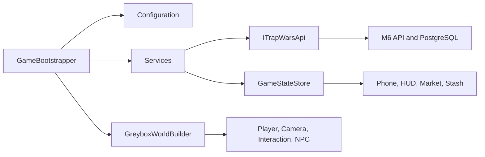

# Unity Architecture

Status: M7.5 game-feel implementation accepted; authoritative architecture unchanged

## Locked toolchain

- Editor: Unity `6000.3.20f1`, revision `c9ba695d4f07`.
- Render pipeline: Universal Render Pipeline `17.3.0`.
- Primary development target: Windows desktop.
- Future targets: Web and mobile, subject to build profiling.
- Project root: `game/unity/`.

`ProjectSettings/ProjectVersion.txt` locks the editor. `Packages/manifest.json` pins direct package versions. Editor upgrades require an explicit migration branch, package review, compile, tests, and visual comparison.

URP is selected because it has the broadest fit across Windows, mobile, and eventual browser builds while retaining room for better materials, lighting, post-processing, and quality tiers. HDRP is intentionally excluded because it conflicts with the scalability and Web goals. M7 uses primitives, modest real-time lights, and no final post-processing.

## Composition and authority

`GameBootstrapper` is the single composition root. It loads runtime and accessibility configuration, constructs API/auth/run/state/analytics/audio services, authenticates, loads or creates the authoritative run, builds the greybox, spawns the player, and wires presentation controllers. Gameplay initialization is not spread across unrelated `Start()` methods.

Unity owns locomotion, camera, animation presentation, interaction discovery, dialogue, UI, sound, lighting, and response staging. The M6 API owns cash, inventory, stash state, prices, legal actions, days, progression, random outcomes, and committed events. `GameStateStore` is replaced from server projections; UI does not mutate economic state.

## Runtime layers

| Layer | Responsibilities |
| --- | --- |
| `Bootstrap` | Ordered startup and dependency composition |
| `Config` | API environment, retry/timeout, sensitivity, accessibility preferences |
| `Networking` | Strong DTOs, HTTP transport, normalized errors, exact-request retry, mock adapter |
| `Services` | Authentication, run coordination, resume locator, analytics/audio/dialogue contracts |
| `State` | DTO-to-presentation mapping and current projection |
| `Player` | Input actions, CharacterController motor, contextual camera, replaceable procedural humanoid/animation bridge |
| `Interaction` | Generic nearest interactable scan and contextual prompt |
| `World` | Compact modular greybox, optional clues, ambient pedestrians/traffic, and interaction wiring |
| `Phone`, `Market`, `UI` | Non-authoritative presentation and command anticipation |
| `Objectives`, `Time` | Local guidance and presentation of server-owned progression |

## Content and scene strategy

M7 uses one lightweight template scene and generates `VERTICAL_SLICE_CITY_TBD` at runtime. The generated hierarchy contains `safehouse_01`, `district_01`, and `market_hub_01`; no real city is a world/content identity. The current M6 projection may return a legacy location wire value such as `compton`. Unity treats that as an opaque API value for location-bound stash commands and never presents it as the greybox city name.

Dialogue is held in `DialogueSequence` ScriptableObjects. The M7 sequence is created at composition time; authored assets and localization tables should replace that temporary content path before production. Character visuals are replaceable children of the motor root.

## Input, accessibility, and Web

`PlayerInputReader` centralizes Input System actions for keyboard/mouse and gamepad. Gameplay consumes `IPlayerInputSource`, allowing later rebinding, mobile input, and automated input. `AccessibilitySettings` persists bounded text scale, master volume, sensitivity multiplier, and caption preference. UI text uses responsive wrapping and best-fit limits; dialogue is the current caption surface.

Potential Web work: validate threading/browser behavior for async `UnityWebRequest`, memory for URP assets, persistent token storage, CORS, and build size. AI Navigation and Timeline are pinned but are not required by the current runtime path and can be removed if Web profiling shows cost.

## Testing strategy

Edit-mode tests cover DTO parsing, detached presentation mapping, command construction, environment configuration, idempotent mock replay, conflict reconciliation, and the real Unity adapter/API/PostgreSQL path. Play-mode tests cover the humanoid hierarchy/phone state, objective order including investigation/review, Day 2 resume, and physical nearest-interaction behavior. Runtime, EditMode tests, and PlayMode tests also have a license-independent Roslyn compile check using the exact installed Unity template assemblies.

Unity Personal is active. Final M7.5 execution passed 6/6 EditMode and 5/5 PlayMode tests in Editor `6000.3.20f1`; visible Play Mode, performance sampling, screenshots, authoritative trade, conflict/idempotency, network loss, and save/resume are recorded in `M7_5_GAME_FEEL_ACCEPTANCE.md`.

## Production boundaries

- `MockTrapWarsApi` is opt-in; local real API is the default.
- `DevProjectionPersistence` stores the development guest token and run locator in PlayerPrefs. It never stores or overwrites economic state. Production identity must use platform-secure token storage.
- Buffered analytics currently proves non-blocking client observation and bounded memory. A production ingestion transport, consent policy, and offline persistence remain deferred.
- Procedural tones/noise are legal temporary audio architecture proof, not final assets.
- Development tools compile only for Editor/development builds and expose no secrets.

## M8 visual production extension

M8 adds a replaceable presentation layer without changing server authority. `ProductionCharacterPresenter`, `M8AssetRuntime`, `M8AtmosphereDirector`, and `M8QualityController` consume role/resource configuration while gameplay continues to publish intent through existing motor, animation, camera, objective, and service interfaces. Editor-only `M8AssetPipeline` and `M8EvidenceRunner` provide import QA, controller generation, Development Player builds, quality inspection, and deterministic acceptance evidence.

The M8 runtime set is a production-pipeline proof, not final art. CC0 character/environment assets are PRODUCTION CANDIDATE; procedural geometry/audio and the built-in font remain TEMPORARY. Detailed replacement rules and acceptance results are in `M8_VISUAL_PRODUCTION_PIPELINE.md` and `M8_INVESTOR_DEMO_ACCEPTANCE.md`.
