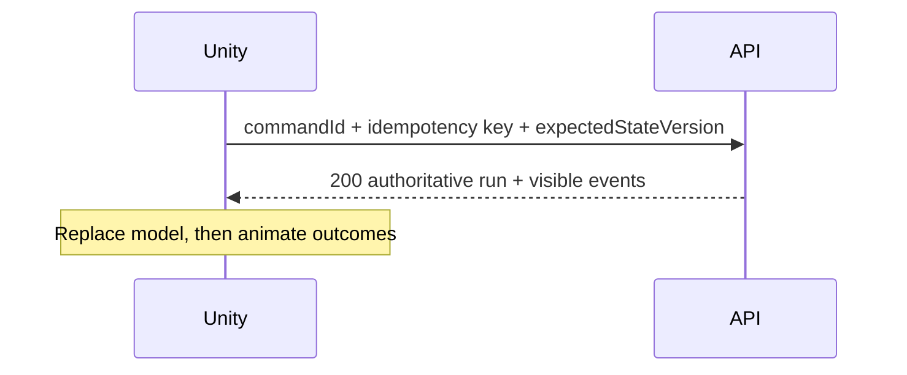

# Unity Client Contract for M7

M7 now implements this M6 integration boundary under `game/unity/`. `UNITY_API_INTEGRATION.md` records the concrete adapter, retry, conflict, and resume behavior. Runtime acceptance remains pending Unity Editor activation.

## Authority rule

Unity may render, animate, cache, and request. It must not calculate authoritative prices, legality, cash, inventory, risk outcomes, random rolls, progression, score, or final wealth. The latest server projection is the source for economic UI.

## Session flow

1. Call `POST /api/v1/auth/guest` with `{}` for the M6 integration path.
2. Keep the returned bearer token in memory or platform-secure storage; never log it.
3. Send it as `Authorization: Bearer <token>` for all run requests.
4. Treat `401 AUTH_REQUIRED` as a session recovery/sign-in transition, not a gameplay rejection.

Final account linking, refresh rotation, recovery, and secure platform storage are M7+ identity work.

## Run flow

1. Generate a unique `Idempotency-Key` and call `POST /api/v1/runs` with `{}`.
2. Store `run.runId`, `run.stateVersion`, and the entire safe projection.
3. Use `GET /api/v1/runs/{runId}` after reconnect, app resume, uncertain network completion, or reconciliation.
4. Build available interactions from `run.legalActions`; do not independently infer legal economy actions.

## Command flow

1. Generate one stable `commandId` and one stable `Idempotency-Key` before sending.
2. Include the last observed `expectedStateVersion` and a typed command payload.
3. Disable or mark that exact intention pending while the request is in flight.
4. On `200`, replace the authoritative model with `response.run`, then stage presentation from `response.events`.
5. If the network result is unknown, retry the exact request with both original IDs. Never generate new IDs for a retry.

## Error handling

| Error | Unity behavior |
| --- | --- |
| `COMMAND_REJECTED` | Keep current authoritative state, display a mapped reason, refresh legal actions from error details |
| `STATE_CONFLICT` | Replace state from `error.details.run`, clear stale pending UI, let the player retry as a new intention |
| `IDEMPOTENCY_CONFLICT` | Stop automatic retry and report a client ID-generation fault |
| `RUN_NOT_FOUND` | Return to run selection/recovery without revealing ownership details |
| `RATE_LIMITED` | Respect `retryAfterMs`; do not spin retries |
| `INTERNAL_ERROR` | Keep the command IDs and offer a bounded retry because commit status may be unknown |

## DTO and presentation rules

- Use 64-bit integer-capable C# fields for money, quantities, sequence values, and state versions.
- Treat IDs and enum strings as opaque protocol values.
- Ignore unknown response fields for forward compatibility; never send unknown request fields.
- Do not persist or expect a run seed, random evidence, processed-command fingerprints, forecast source quality, or future rolls.
- Events are cues after commit. Animation failure must not roll back or reinterpret server state.
- API version (`v1`) is independent of the economy/content/balance/random versions pinned to the run.

## M7 implementation record

- Strict request/response DTOs and a detached presentation model are implemented.
- `UnityTrapWarsApi` owns bearer auth headers, command serialization, timeouts, and bounded exact-request retries.
- `GameRunService` and `GameStateStore` own the current safe projection and conflict reconciliation.
- `MockTrapWarsApi` implements the same interface for deterministic Editor work; real API remains the default.
- Source tests cover DTO mapping, command identity, duplicate replay, stale conflict reconciliation, environment configuration, objective order, and interaction selection.
- Unity Test Runner execution, rejection-map breadth, reconnect acceptance, and terminal-day coverage remain follow-up acceptance work.
- Base, wallet custody, persistent Heat, and client-side economy authority remain excluded.
