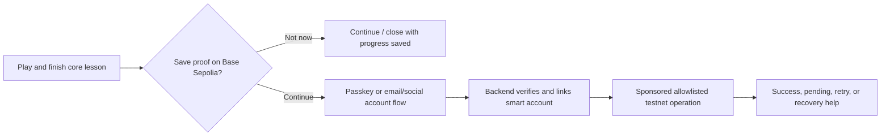

# Trap Wars Unity Vertical Slice Specification

Status: approved specification; M7.5 Day 1 game-feel slice accepted, M8 not started
Date: 2026-08-11
Target play time: 15-25 minutes
Implementation begins: M7, after analytics and economy-engine foundations

Implementation note (2026-08-17): M7.5 validates the first 8-12 minute Day 1 portion of this broader 15-25 minute target. It covers safehouse, phone, investigation, Ray, one market decision, consequence/liquidity reveal, night, and the Day 2 hook. Base onboarding and the remaining production-slice scope stay deferred to an explicitly approved M8.

## 1. Slice thesis

The vertical slice must prove that Trap Wars is a premium playable game whose street-market decisions teach financial concepts through consequence. It is not a 3D menu around the Telegram prototype and not a crypto onboarding demo.

The slice succeeds when a new player can:

1. Understand a rumor in natural street language.
2. Move through a convincing neighborhood and talk to a credible contact.
3. Evaluate cash, product, risk, information quality, and time.
4. Commit a simulated trade while the world continues around them.
5. React when conditions change.
6. Feel a meaningful profit or loss.
7. Recognize the formal financial concept only after experiencing it.
8. See character, access, and knowledge progression.
9. Optionally create/link a Base-compatible account without blocking play.
10. End at night with a reason to return for another day.

## 2. Proof pillars

| Pillar | What the slice must prove | Evidence |
| --- | --- | --- |
| Gameplay | Movement, dialogue, information, trade, event, reaction, consequence form a satisfying loop | Completion and replay intent; command/event trace |
| Culture | Place, language, contacts, music, fashion, and environmental storytelling feel authored rather than decorative | Playtest comprehension and authenticity review |
| Financial learning | Experience precedes terminology; the reveal accurately explains cause and effect | Pre/post concept question and reveal engagement |
| Premium presentation | Controls, camera, animation, audio, lighting, transitions, and consequence feedback feel deliberate even in greybox | Frame captures, feel review, performance data |
| Base onboarding | Optional testnet account flow is understandable and low-friction | Funnel completion, time, error, and abandonment |
| Scalability | Unity does presentation while API/economy engine authoritatively resolves economic actions | Replayable server records and reconnect recovery |

## 3. Scope boundary

### In scope

- One dense neighborhood district identified as `VERTICAL_SLICE_CITY_TBD` until location selection is approved.
- One safehouse interior and immediate exterior block.
- One playable character with a defined presentation target.
- One primary contact and 4-8 ambient NPC archetypes with variation.
- Trap Phone with one authored Word on the Street opportunity.
- One market view, one core product opportunity, one stash interaction, and one travel transition/hook.
- Cash, inventory, risk, time, information confidence, and simple reputation/access feedback.
- One controlled market disruption with at least two valid player responses.
- Profit/loss consequence and one educational reveal.
- Day-to-night transition and closing hook.
- Optional Base Sepolia smart-account onboarding proof.
- Full analytics taxonomy required for the slice.
- Authoritative command path for all balance-changing actions.

### Out of scope

- Full six-city open world.
- All 30 playable days.
- Multiplayer combat, territory wars, crews, or social world.
- Production leaderboard.
- Real money, deposits, withdrawals, yield, token, NFT, marketplace, vault contract, or reward distribution.
- Mainnet.
- Full character creator, vehicle driving, weapons/combat, police AI, or procedural city generation.
- Final marketplace/admin/social web platform.
- A promise that every current Telegram mechanic appears in 3D.

## 4. Setting and spatial plan

Working identifier: **`VERTICAL_SLICE_CITY_TBD` - The Home Block**.

The current Compton walkthrough is illustrative only. Final location selection must compare cultural authenticity, narrative usefulness, visual identity, production cost, environment reuse, gameplay density, investor presentation, and technical feasibility. Scene contracts, mission logic, analytics, economy rules, dialogue references, and asset-addressing conventions must use stable location IDs and data definitions so the selected city can change without rewriting gameplay systems.

```text
Safehouse interior
  -> front room / Trap Phone onboarding
  -> wardrobe/mirror character signal
  -> stash interaction point
  -> exterior threshold

Home block
  -> apartment frontage and courtyard
  -> corner store / market access
  -> contact meeting point
  -> alley shortcut and risk beat
  -> ambient social pocket
  -> transit boundary / next-neighborhood hook
```

The playable footprint should be small enough that every 10-20 seconds reveals information, interaction, or mood. A five-minute empty walk is a failure. Streets outside the footprint can provide depth through blocked geometry, traffic, distant NPCs, transit, audio, and lighting rather than explorable acreage.

## 5. Emotional and gameplay arc

The target run below is authored for approximately 20 minutes. Timing ranges allow exploration and accessibility needs.

### 5.1 Open: 0:00-2:30

Player wakes/enters control inside the safehouse.

Environmental story communicates current status without exposition:

- Limited cash and practical possessions.
- A protected envelope/lockbox motif that foreshadows reserves.
- A neighborhood map and contact history.
- Signs that this is day one of a larger climb.

First control moments:

- Immediate responsive movement and camera.
- One optional inspection interaction.
- Trap Phone vibrates and receives `WORD ON THE STREET`.
- Rumor: a nearby event/contact is driving demand for a product, but source certainty is not perfect.

Player sees street-language information only: source, location, time pressure, likely demand, and an implied risk. The game does not yet display `liquidity`, `volatility`, or `slippage` as tutorial terms.

Required events: `session.started`, `player.spawned`, `rumor.received`, and normalized onboarding step events.

### 5.2 Investigate: 2:30-7:00

Player exits to the block.

- Door, threshold, light, and audio transition sell the move from private safety to public risk.
- Ambient NPCs converse, react, cross paths, and occupy space without becoming interaction icons everywhere.
- The primary contact is visible through staging, gaze, and context rather than a floating quest marker alone.
- Contact explains the opportunity in natural language and adds one piece of uncertainty the phone did not contain.
- Player can ask one or two concise follow-up questions about timing, source, and downside.

The dialogue does not freeze the world. Nearby motion and audio continue at a controlled level. The player retains limited camera agency unless a short cinematic composition is justified.

Required events: `travel.started`, `travel.completed`, `npc.interaction_started`, `npc.interaction_completed`, `rumor.investigated`, and dialogue choice events.

### 5.3 Decide: 7:00-10:00

Player reaches the market interaction point or opens the phone market contextually.

Decision surface shows:

- Spendable cash.
- Protected reserve as unavailable for this trade.
- Current inventory and capacity.
- Current quote and rumor direction.
- Information confidence and time remaining.
- A readable risk indicator expressed in-world first.
- Three authored stake sizes: conservative, balanced, aggressive, plus an accessible custom amount if time permits.

The UI does not expose unnecessary DeFi terminology. It gives enough information for a meaningful choice and makes the tradeoff legible.

The client sends a `market.trade.request`; the server validates funds, capacity, market state, run version, and command idempotency, then returns the committed result.

Required events: `market.viewed`, `market.trade_requested`, and `market.trade_completed` or `market.trade_rejected`.

### 5.4 Execute: 10:00-12:00

The purchase is staged as action in the world:

- Character and seller orient correctly.
- Hand/phone/prop placement is believable.
- Cash and inventory feedback is immediate but not arcade clutter.
- Ambient world continues.
- The player physically leaves with a changed state and visible/audible confirmation.
- A short stash option lets the player protect part of the position at the cost of time or flexibility.

The server owns resulting quantities and cash. Unity uses returned presentation cues to animate the exchange; it does not calculate success.

### 5.5 Event: 12:00-15:30

After the player commits, an authored market change occurs. Recommended first scenario:

- Demand initially rises as rumored.
- A competing supply appears or the expected buyer pool thins.
- Available exit depth shrinks before the headline price fully communicates the problem.
- Phone/contact/environment signals arrive in different forms.

The player chooses:

- Exit now with a smaller but safer result.
- Wait for a better quote while accepting downside.
- Move to the stash/contact to reduce exposure or preserve optionality.

The economy engine owns scenario state, quote/depth, time window, and selected consequence. The world presents it through crowd behavior, contact reaction, phone messages, music tension, and market UI.

Required events: `market.condition_changed`, `market.event_presented`, second market view, reaction command, and time-to-decision.

### 5.6 Consequence: 15:30-17:30

The outcome must feel physical and economic:

- Profit: restrained but satisfying sound, character/contact reaction, safehouse/progression signal, and clear balance change.
- Loss: dropped energy in audio, credible contact response, visibly reduced options, and no mocking or shame.
- Near miss: communicate what was preserved and what opportunity was lost.

Show before, delta, after, and the reason. Do not obscure a loss behind celebratory progression.

Server emits authoritative `economy.outcome_resolved` and `progression.changed` events.

### 5.7 Educational reveal: 17:30-19:00

Only now map experience to formal language.

Primary concept for the first slice: **LIQUIDITY**.

Reveal structure:

1. `What you felt`: the displayed price looked attractive, but fewer buyers were available at that price.
2. `What happened`: selling the chosen size moved through thinner demand and worsened the realized exit.
3. `The term`: liquidity is how easily an asset can be bought or sold without moving its price too much.
4. `Your evidence`: replay the player's quote, chosen size, realized price, and difference.
5. `Try next time`: smaller size, earlier exit, better market, or waiting for deeper demand.

Secondary vocabulary such as volatility or slippage can appear as optional follow-up, not as a glossary dump.

Required events: `education.reveal_shown`, `education.reveal_completed`, time visible, expanded/collapsed details, and optional behavioral/comprehension evidence.

### 5.8 Progression: 19:00-21:00

Apply a bounded result:

- Cash change.
- Protected-reserve change only if the authored slice uses the savings lesson.
- Reputation/access change tied to how the player handled risk, not just profit.
- Knowledge entry for Liquidity.
- Small safehouse, clothing, contact, or next-opportunity signal.

Do not award a token, NFT, or real-value claim.

### 5.9 Optional Base onboarding: 21:00-23:00

After the player has completed the learning arc, offer an optional account benefit such as preserving a verified achievement proof on Base Sepolia.

- Explain the player benefit in game language before mentioning chain details.
- Allow `Not now` with no punishment or lost progress.
- Use passkey or email/social flow selected in M8.
- Link the resulting smart account to the existing Trap Wars profile.
- Sponsor one allowlisted valueless testnet operation.
- Show pending, success, failure, retry, and recovery/help states.
- Never ask for or display a seed phrase.

The Base flow may be disabled for playtests focused on core gameplay. The slice is not considered broken when onboarding is skipped.

### 5.10 Close: 23:00-25:00

- Time transitions into night through lighting, traffic, NPC population, windows, signage, and audio.
- Player returns toward the safehouse or reaches the transit boundary.
- Trap Phone receives a new contact or next-neighborhood rumor.
- The final frame promises another day through an actionable hook, not a roadmap screen.
- End summary is concise: outcome, concept learned, access gained, and next lead.

Required events: `day.completed`, `run.progressed`, and session end/continue intent.

## 6. Core state for the slice

Authoritative state subset:

```text
SliceRun
  id, playerId, stateVersion
  economy_version, content_version, balance_version, random_strategy_version
  phase, gameClock, daySegment
  locationZone
  cashMinor, protectedMinor
  inventory[]
  capacity
  activeRumors[]
  marketScenario
  contactProgress
  reputation
  knowledgeUnlocks[]
  walletOnboardingStatus
  completionStatus
```

Client presentation state can include camera, animation, local navigation, ambient NPCs, particles, audio emitters, opened panels, and interpolated UI values. None may overwrite authoritative fields.

## 7. Economy scenario specification

The first authored scenario must be deterministic under a known test seed and support bounded variants.

Inputs:

- Rumor confidence tier.
- Initial cash and protected reserve.
- Three position sizes.
- Initial quote, depth bands, and time window.
- Event branch and timing.
- Exit choices.

Outputs:

- Filled quantity and average entry price.
- Remaining cash and inventory.
- Market condition change.
- Realized exit price and profit/loss.
- Protected/reserve allocation if enabled.
- Reputation/access/knowledge result.
- Presentation cue set.

At least these test paths must exist:

1. Conservative early exit with small profit.
2. Balanced response with meaningful profit and complete learning evidence.
3. Aggressive hold into thin liquidity with a clear loss.
4. Stale-state/retry path that returns the committed result once.
5. Disconnect after trade commit and successful authoritative recovery on reconnect.

## 8. Interaction and control requirements

Premium feel begins in the first greybox.

### 8.1 Player movement

- Responsive acceleration and deceleration; values tuned through playtest, not default controller settings.
- Smooth heading changes with no visible foot sliding at target speeds.
- Input buffering for interact and contextual actions during short animation transitions.
- Walk and jog at minimum; sprint only if it improves the small space.
- Clear collision, step, slope, and doorway behavior.
- No animation root-motion conflict that makes the player feel delayed or dragged.
- Controller and keyboard/mouse supported from first playable milestone.

### 8.2 Camera

- Third-person follow camera with collision avoidance, shoulder framing, and stable horizon.
- Tunable sensitivity, invert-Y, aim/interaction framing, and reduced-motion option.
- No camera snap on interaction unless authored and brief.
- Dialogue framing respects NPC eye line while preserving spatial context.
- Camera cannot clip through safehouse walls, character head, or close props.
- Consequence shots are short and skippable after first view.

### 8.3 Contextual interaction

- Interaction candidates filtered by distance, view direction, reachability, and current phase.
- One stable contextual prompt; candidates do not flicker when the player moves slightly.
- Hold actions only when the hold communicates commitment or prevents costly mistakes.
- Server rejection is translated into diegetic/clear feedback and never leaves the character stuck in an animation.
- Interaction distance, prompt timing, and cancellation are analytics fields during greybox tuning.

## 9. Animation system requirements for the slice

This section establishes technical requirements early; a dedicated animation document follows after M3 approval.

### 9.1 Locomotion

- Animator state machine with grounded locomotion, start, stop, pivot, turn-in-place, and interaction layers.
- 2D blend tree for direction/speed where strafing is used; simpler 1D speed tree for free locomotion if tests feel better.
- Authored start/stop clips or motion matching only if they improve responsiveness within budget.
- Additive upper-body layer for phone use, glances, and dialogue gestures while lower-body locomotion continues.
- Foot phase consistency and foot-lock strategy to limit sliding.

### 9.2 IK and procedural motion

- Foot IK for uneven thresholds/curbs, disabled or blended where it causes instability.
- Hand IK/contact targets for phone, doors, counter exchanges, and selected props.
- Look-at/head tracking with clamped angles, attention targets, dwell, and natural release.
- NPC orientation solver before dialogue begins; no instant full-body rotation.
- Procedural breathing, micro-look, and stance variation are allowed as additive low-cost layers.
- Procedural systems must have deterministic presentation inputs where recorded cinematics/tests require repeatability.

### 9.3 Interaction animation

Minimum authored sets:

- Phone receive, raise, use, lower.
- Door open/close and threshold pass.
- Counter/hand exchange with left/right variants or robust IK.
- Stash access and item placement/retrieval.
- Contact greeting, listening, emphasis, warning, approval, disappointment.
- Outcome reactions for player and contact.
- Seated/leaning/idle ambient poses for NPC population.

Animation events may trigger presentation only. They do not commit economy changes. Server result arrives before irreversible outcome staging, with timeout/fallback behavior.

### 9.4 Face, dialogue, and cinematics

- Facial system supports eye blink, gaze, brows, mouth shapes, and expression presets.
- Lip sync can be generated from final dialogue audio, then hand-corrected for hero contact lines.
- Gesture tags or authored clips align with dialogue beats without one gesture per sentence.
- Short cinematic timeline for opening and closing only if it preserves control handoff quality.
- Dialogue supports subtitle timing, speaker labeling, skip/advance policy, and localization expansion.
- Facial LOD disables expensive deformation for distant ambient NPCs.

### 9.5 Retargeting and variation

- Use one approved humanoid rig standard and document scale/orientation/import settings.
- Retarget tests cover playable body, primary contact, and at least two ambient body types before animation production scales.
- NPC variation combines body/wardrobe/material/idle/voice/behavior within cultural direction; do not rely on palette swaps alone.
- Authored hero animation is reserved for opening, primary contact, trade exchange, consequence, and close.
- Procedural/look-at/IK systems cover repeated interactions and ambient variation.

### 9.6 Animation budgets

- Maximum four full-quality characters near camera in the slice; larger crowds use simplified rigs/updates.
- Animator and IK update rates may scale by distance, but visible cadence changes are unacceptable.
- Target animation CPU budget: <= 3 ms on representative desktop at high quality and <= 5 ms on minimum WebGL target.
- Cap active skinned renderers and bone counts through measured profiling; provisional hero rig target is 120-160 deform bones, ambient LOD rigs materially lower.
- No per-frame allocations in locomotion, IK, look-at, or prompt selection during steady state.

## 10. UI and Trap Phone

### 10.1 HUD

Persistent HUD is restrained:

- Cash.
- Inventory/capacity signal.
- Current objective or rumor timer.
- Contextual prompt.

Protected reserve, reputation, and knowledge appear when relevant rather than filling the screen continuously.

### 10.2 Trap Phone

Slice apps:

- Messages: rumor and contact thread.
- Market: current quote, depth/risk summary, position, and action.
- Map: safehouse, contact, market, stash, transit boundary.
- Knowledge: unlocked Liquidity reveal after consequence.
- Profile/account: optional Base onboarding entry after progression.

Do not implement empty News, Gang, Upgrades, and Settings apps just to reproduce the prototype grid. Every visible app in the slice must work.

### 10.3 UI behavior

- Phone opens/closes with animation and audio but stays fast enough for repeated use.
- World can continue at reduced intensity; pause behavior is an explicit accessibility/design choice.
- Gamepad focus, keyboard navigation, pointer input, and readable focus states are required.
- Subtitles, text size, contrast, color-independent profit/loss cues, and reduced motion are required for playtests.
- Financial numbers use consistent units, separators, sign, before/delta/after, and plain-language reason.

## 11. Audio requirements

- Exterior ambience: traffic layers, distant voices, birds/insects as place-appropriate, HVAC/electrical texture, occasional transit or siren used with restraint.
- Interior safehouse room tone, neighbor/building bleed, device vibration, and material-specific footsteps.
- Dynamic music states: safehouse, street investigation, decision tension, market event, consequence, night close.
- Music transitions are bar-aware or intentionally crossfaded; no hard loops during dialogue.
- Dialogue priority ducks competing midrange without making the world silent.
- UI sounds communicate phone, valid action, commitment, warning, authoritative rejection, profit, and loss.
- Profit and loss cues must remain distinguishable without stereo or high volume.
- Provisional delivery: compressed streaming music/ambience, compressed dialogue by platform, short UI/foley clips decompressed only when profiling supports it.

## 12. Visual direction and provisional asset budgets

The slice targets premium contemporary street editorial and grounded cinematic realism. It should not inherit the old one-note cyberpunk-terminal presentation by default.

These are provisional M3 constraints; `ASSET_REQUIREMENTS.md` will finalize them after technical spikes.

### 12.1 Characters

- Playable and hero contact: approximately 80k-120k rendered triangles at LOD0, 40k-60k LOD1, 15k-25k LOD2.
- Ambient NPC: approximately 35k-70k LOD0 depending on screen role, with aggressive lower LODs/impostor strategy where justified.
- Mostly 2K texture sets for hero characters; 4K only when close-up evidence proves need and streaming budget permits.
- Shared wardrobe materials/atlases and controlled material slots.
- Hair cards or optimized hair solution validated in WebGL early; no unbounded strand system assumption.

### 12.2 Environment and props

- Modular kit with measured texel density and trim sheets.
- 2K for hero surfaces/atlases; 1K or smaller for ordinary props; 4K only for large shared atlases or unique hero surfaces.
- Every medium/large mesh has authored LODs or validated automatic LODs.
- Small clutter uses instancing/atlasing and distance culling.
- Occlusion culling and additive scene/Addressables strategy tested in the actual block layout.
- Visible geometry targets: <= 2 million triangles high-quality desktop view, <= 1 million medium WebGL view, subject to GPU profiling.
- Visible draw-call target: <= 800 high and materially lower on medium through batching/instancing.

### 12.3 Shaders and lighting

- One primary physically based shader family plus tightly controlled special cases.
- Avoid large variant explosion, layered transparency, expensive full-screen effects, and many shadowed lights.
- One real-time directional key light; baked/mixed contribution for environment where the day-night transition permits.
- Local shadowed lights are rare and budgeted by shot/zone.
- Reflection probes and light probes support characters and interiors.
- Day-to-night can blend baked scenarios, light layers, or authored lighting states; technical spike decides the approach.
- VFX favor authored meshes/particles and screen-space restraint over expensive transparent overdraw.

## 13. Browser and performance constraints

Primary slice delivery assumption: desktop standalone for highest-fidelity reviews plus desktop WebGL as a measured distribution target. Mobile WebGL is not promised until profiling proves it.

Provisional targets:

- 60 fps at 1080p high on representative discrete-GPU investor hardware.
- Stable 30 fps at 900p/1080p medium on the defined integrated-GPU minimum.
- No frame above 100 ms during normal traversal after initial warmup.
- Initial playable compressed download target <= 120 MB; total slice content target <= 250 MB, subject to a build spike.
- Peak browser memory target <= 1.5 GB on the supported desktop matrix.
- First meaningful visual quickly, with progress and recoverable errors during download/compile.
- Shader warmup/preloading avoids first-use stalls at dialogue, market, consequence, and night transition.
- Audio streaming and texture compression selected per platform.
- Quality tiers change shadows, resolution, crowd, LOD, post effects, and reflection quality without changing gameplay information.

The M7 kickoff requires a blank-scene WebGL pipeline test, representative character test, safehouse lighting test, and memory/build-size report before asset production accelerates.

## 14. Base onboarding UX in the slice

The player first authenticates to Trap Wars, not to a wallet.



Required safety copy:

- Testnet and no real monetary value.
- Trap Wars never asks for a seed phrase or private key.
- What the account does for the player now.
- What happens if they lose access to the chosen login/passkey method.
- How to skip, retry, unlink where policy allows, and obtain support.

No wallet modal may appear during the opening, investigation, decision, or consequence beats.

## 15. Analytics and learning measurement

In addition to the normalized M4 taxonomy, the slice records:

- Time to first movement and first phone open.
- Prompt visible-to-interact time and prompt cancellation.
- Rumor read duration and optional details opened.
- Contact dialogue branches and skip behavior.
- Position size selected and amount changed before commit.
- Trade rejection reason and retry outcome.
- Reaction time after market event.
- Realized profit/loss and chosen response.
- Educational reveal viewed, expanded, dismissed, and comprehension response.
- Return-to-safehouse/close completion.
- Frame time, memory, quality tier, crashes, and disconnect/reconnect.
- Base onboarding viewed, started, step completed, linked, failed, abandoned, and total time.

Analytics cannot store dialogue free text, secrets, or unnecessary personal data. Server economics and client UX events are joined through pseudonymous IDs and correlation IDs.

Learning success metrics:

- Player can explain why displayed price differed from realized outcome in plain language.
- Player identifies one strategy that reduces liquidity risk.
- Reveal completion does not require a long forced quiz.
- Correct understanding is compared with actual decision history, not self-report alone.

## 16. Failure, reconnect, and edge states

- API unavailable before commitment: block the economic action, keep movement available, explain retry.
- Timeout after request: retry same `commandId`; server returns original committed result if accepted.
- Disconnect after commit: recover authoritative run snapshot and stage missed consequence safely.
- Stale state: refresh, explain changed conditions, require reconfirmation if price/result changed materially.
- Invalid/insufficient funds: no animation implying a completed exchange.
- Wallet provider unavailable: core game remains complete; Base flow offers retry/not now.
- Base transaction pending beyond session: show linked pending state on profile and resolve asynchronously.
- Save conflict: server snapshot wins; local presentation settings merge separately.
- Unsupported hardware/WebGL: offer lower quality or standalone path with clear diagnostics.

## 17. Test strategy

### 17.1 Automated

- Economy-engine unit and property tests for all scenario branches and numeric boundaries.
- API contract tests for auth, authorization, idempotency, stale versions, reconnect, and outbox.
- Golden command/event replay tests.
- Unity edit-mode tests for data parsing and state adapters.
- Unity play-mode tests for phase flow, interaction gating, save recovery, UI focus, and animation fallback.
- Generated C# API client compatibility check in CI.
- Build smoke tests for standalone and WebGL.
- Performance capture on representative scenes and hardware.

### 17.2 Manual/playtest

- Fresh-player 15-25 minute completion without facilitator help.
- Controller and keyboard/mouse passes.
- Reduced motion, subtitles, text scale, color-vision, and remapping review.
- Cultural authenticity review with compensated reviewers appropriate to the represented place and audience.
- Financial-learning accuracy review.
- Content/platform/legal review before investor distribution.
- Offline, slow network, API restart, and wallet-provider outage drills.

## 18. Acceptance criteria

### Gameplay and narrative

- 80% or more of target playtesters complete the core arc without facilitator rescue.
- Median core completion falls within 15-25 minutes.
- At least two decision paths produce clearly different but coherent consequences.
- Player never needs chain knowledge to complete the core arc.
- Night close reliably produces a next-day hook.

### Game feel

- No known camera clipping, stuck interaction, foot-sliding blocker, or input-loss defect in the golden path.
- Interactions respond immediately or show intentional pending feedback within 100 ms.
- Dialogue, gesture, and NPC orientation pass a dedicated feel review in greybox.
- Audio and UI communicate success, rejection, profit, and loss independently.

### Technical authority

- Every cash/inventory/progression mutation originates from a committed server command.
- Duplicate command tests never duplicate value.
- A completed run can be replayed from stored command/random decision evidence.
- Reconnect after each economic phase restores the correct authoritative state.
- Unity contains no production secret and no endpoint can accept a client-supplied result balance.

### Performance

- Meets the defined frame-time target on the representative high and minimum systems.
- WebGL build is nonblank, correctly framed, interactive, and completes the golden path in supported browsers.
- Build size, peak memory, shader stalls, draw calls, triangles, animation CPU, and load times are captured and within approved M7 budgets.
- No overlapping or clipped UI at supported resolutions and text scales.

### Learning

- Most tested players correctly describe the experienced liquidity problem in plain language after the reveal.
- The reveal uses the player's actual numbers and decision.
- Profit and loss explanations are accurate and do not imply guaranteed returns.

### Base onboarding

- Optional and skippable with no loss of game progress.
- Uses Base Sepolia and valueless assets only.
- Account ownership is verified server-side and linked to `playerId`.
- Sponsored operation is allowlisted and budget/rate limited.
- Failure/retry/recovery states are tested.

## 19. Milestone dependency and build order

1. M4 finalizes event taxonomy, consent assumptions, and playtest dashboards.
2. M5 creates deterministic economy scenario and characterization tests.
3. M6 exposes authenticated run/command APIs and PostgreSQL state.
4. M7 starts Unity with movement/camera/interaction feel and representative WebGL profiling on day one.
5. Greybox implements the complete emotional arc before content breadth.
6. M8 adds optional Base account onboarding behind a provider abstraction.
7. M9 adds the minimal web platform around the playable build.
8. M10 replaces placeholders and raises art, animation, VFX, audio, cinematics, UI, and performance together.

Premium work is continuous: locomotion, camera, timing, animation transitions, sound feedback, and lighting are reviewed in every playable milestone, not postponed to M10.

## 20. Major risks and mitigations

| Risk | Mitigation |
| --- | --- |
| Slice becomes a walking simulator plus phone menus | Make every spatial transition reveal information, choice, or consequence; test full loop early |
| Premium target exceeds WebGL limits | Representative asset/performance spike before production art; standalone fallback for highest fidelity |
| World action and server response feel disconnected | Presentation cue contract, immediate pending response, short transactions, animation fallback |
| Cultural presentation feels generic or exploitative | Early paid authenticity review, authored specificity, avoid caricature, review language and incentives |
| Education feels like a lecture | Reveal after consequence, use player's data, optional deeper detail |
| Wallet flow overwhelms the game | Place after core value, make optional, test one provider path, Base Sepolia only |
| Current prototype balance bugs leak into V2 | Characterization fixtures plus explicit intentional-change ledger |
| Art breadth delays complete arc | One block, one hero contact, controlled NPC variation, strict asset budgets |
| Drug-market content blocks distribution/partners | Decide audience, age rating, naming/fictionalization, platform strategy, and legal review before scale |

## 21. Exit gate for M3

Approve M3 when stakeholders agree on:

- The one-neighborhood scope and 15-25 minute arc.
- Liquidity as the first formal learning reveal.
- The authored market-event branches.
- Server authority and reconnect behavior.
- The timing and optional nature of Base onboarding.
- The provisional performance and content budgets.
- The cultural/content review process.
- The exact analytics needed before Unity greybox testing.

Approval of this document authorizes planning for M4-M6. It does not authorize Unity implementation, repository migration, contract deployment, or production infrastructure changes.

## M8 implementation note

The implemented M8 hero slice preserves the accepted Day 1 sequence and compact block. It applies production-candidate skinned characters, authored animation controllers, modular CC0 urban assets, original decals, URP materials/post-processing, day/night practical lighting, population quality tiers, separate audio buses, and real Play Mode evidence. No Base account, token, NFT, multiplayer, combat, vehicle gameplay, or M9 work was added.

M8 technical validation passes, but the visual result remains below investor-demo acceptance. See `M8_INVESTOR_DEMO_ACCEPTANCE.md`; the required next gate is owner review of the recommended M8.x polish pass.
